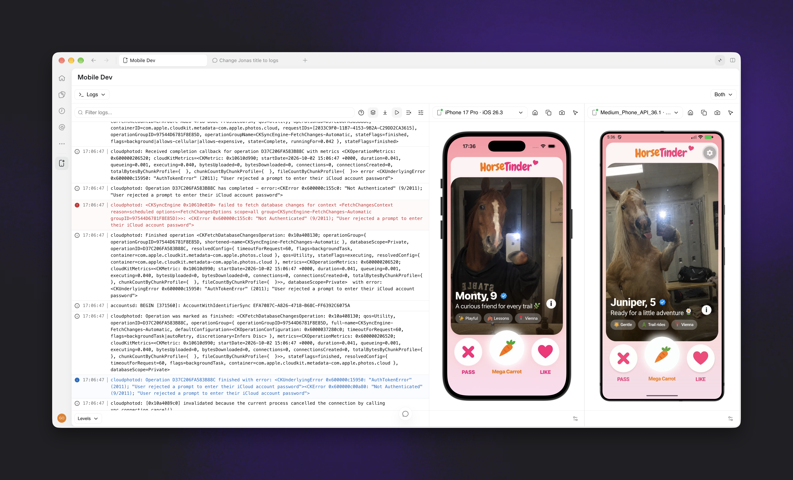
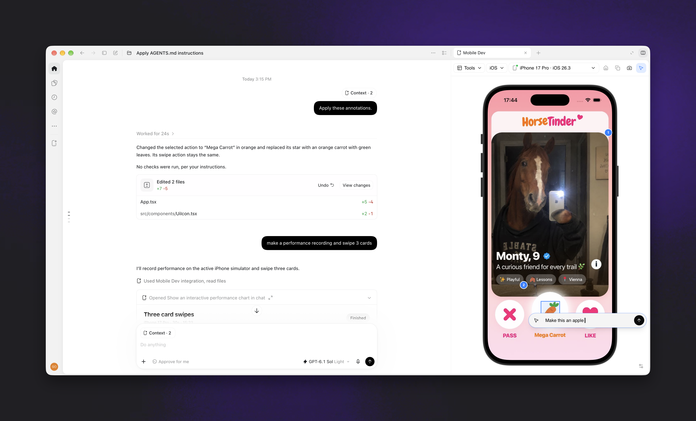
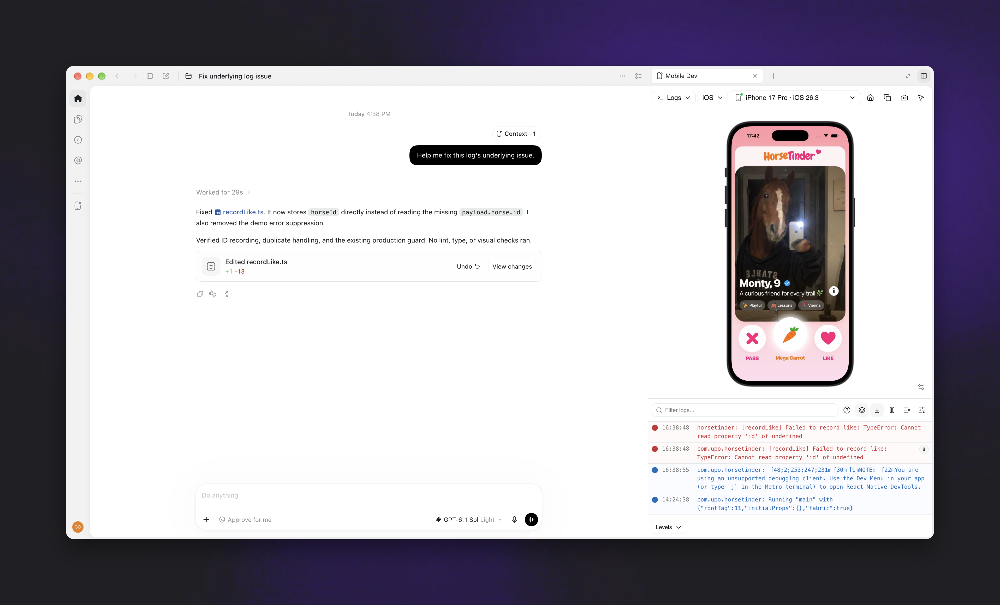
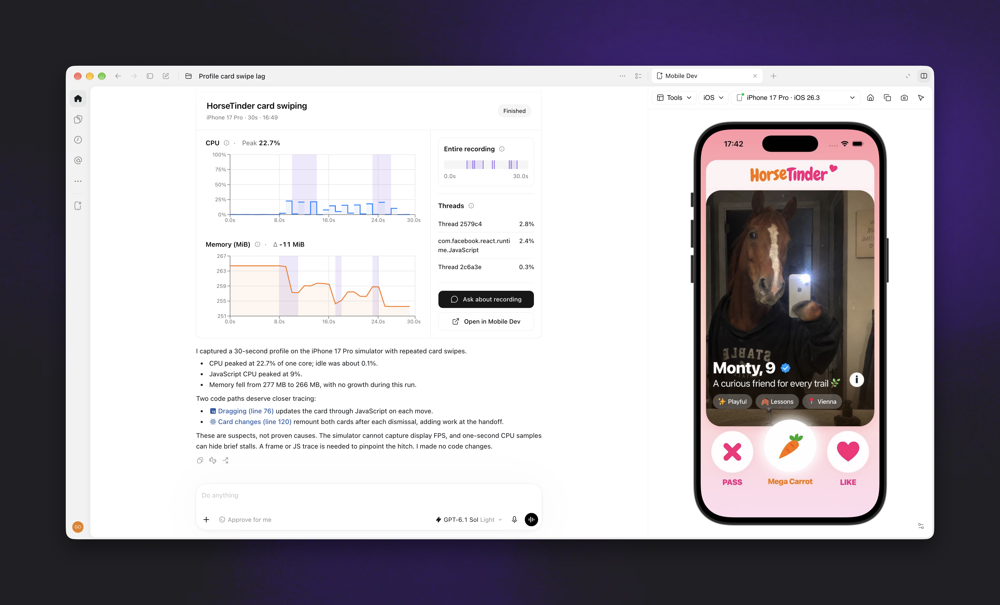

# Mobile Dev for Codex

Build, debug, and improve iOS and Android apps with a live device beside your
Codex chat. Point to a UI element you want to change, share an error from the logs,
and compare performance before and after a fix.

Mobile Dev works with Expo, React Native, SwiftUI, and other native mobile
projects. Use simulators, emulators, or connected phones and tablets, with iOS
and Android side by side or in a fullscreen workspace.



## Install

You'll need **Codex desktop on an Apple Silicon Mac**, plus Xcode for iOS or the
Android SDK for Android. See [Requirements](#requirements) for versions and device
setup.

Run these commands in your terminal to install the prebuilt plugin:

```sh
codex plugin marketplace add https://github.com/callstackincubator/codex-mobile-dev-plugin.git --ref release/latest
codex plugin add mobile-dev@mobile-dev
```

Open a new chat after installing. The package includes its runtimes and uses
Codex's bundled Node; no plugin build or `npm install` is needed.

## Try it with your app

1. Open your app project in Codex and start a new chat.
2. Ask: **"Build and run my app in the simulator beside this chat."**
3. Use the device picker to choose a simulator, emulator, or connected device.
   Selecting a stopped simulator or emulator boots it. Enable iOS and Android
   together to see both platforms.
4. Interact with the app, then open **Logs**, **Performance**, or **Storage** to
   investigate what you see.

You can also open Mobile Dev directly from the Codex sidebar. Codex uses your
project's build and run tools to launch the app; Mobile Dev provides the device
view, controls, and debugging tools.

## Point to what you want to change

Tap, drag, and type in the device panel, or ask Codex to inspect the screen and
interact with your app on an iOS simulator or Android device. Use **Select** to
annotate an element or screen region with an instruction, such as "Add more space
above this button." React Native component and source details are included when
available. Use **Screenshot** to attach an image to your next message.

Physical iPhones and iPads support taps, drags, screenshots, and region annotations;
keyboard, hardware-button controls, and native accessibility element names are
unavailable. On iOS simulators and Android, click the screen and press
**Command-V** to paste up to 4,096 printable US-ASCII characters. Line breaks and
unsupported characters are rejected without sending partial text.



## Turn an error into a fix

Read iOS unified logs, Android logcat, and Metro console messages together.
Follow the foreground app, search and filter the output, then send an error and
its full stack trace to chat for Codex to investigate. Metro logs require a
running local Metro server and a compatible app inspector target.

Try: **"Read the app logs and help me fix this error."**



## Check whether a change improved performance

Watch app CPU and memory, expand individual thread charts, or record an
interaction and inspect the charts in chat. Select a time range to investigate a
spike and compare runs before and after a change. Repeat the same interaction on
the same device and app configuration for a useful comparison.

Try: **"Record CPU and memory for 30 seconds while I scroll checkout."** Then ask:
**"Compare these two performance recordings."**

Supported devices also provide **Display FPS**; Android recordings include frame
pacing and jank statistics. These describe the whole device's display, including
system UI, and cannot attribute a slowdown to one app. iOS simulators support CPU
and memory monitoring, but not Display FPS.



## Inspect saved data and test a fresh state

Open **Storage** to investigate stale settings, cached state, or onboarding flags
without adding code to your app. Browse MMKV, AsyncStorage, UserDefaults,
SharedPreferences, DataStore preferences, SQLite tables, and the largest files in
the app's data directory.

Search across stores or use **Changes** to watch keys being added, changed, and
removed as you use the app. Clear one store or reset all app data to test a fresh
state; either action stops the app and deletes the selected data.

Storage inspection works on iOS simulators and debuggable Android builds. MMKV
value types are inferred from stored bytes, and encrypted MMKV instances stay
locked.

## Requirements

Mobile Dev runs in Codex desktop on an Apple Silicon Mac. Install the tools for
the platforms you use:

| Platform or feature | Requirements |
| --- | --- |
| iOS simulators | Xcode 26 or later with an installed simulator runtime. |
| Physical iPhones and iPads | Xcode 27 or later, a paired device with Developer Mode enabled, and USB or Wi-Fi connectivity. Screen mirroring requires HEVC WebCodecs support in the host. |
| Android | Android SDK platform-tools and emulator, and an AVD or a physical device with authorized USB or wireless debugging. Screen streaming requires H.264 WebCodecs support in the host. |
| Metro logs and React Native inspection | An existing local Metro server with a compatible app inspector target. |
| Physical iOS CPU and memory | iOS 17.4 or later, a running development-signed app with `get-task-allow`, a mounted developer disk image, and Xcode/LLDB detached. |
| Display FPS | Android 12 or later with FrameTimeline support, or a physical iOS device running iOS 17.4 or later. iOS simulators do not support Display FPS. |

Simulator tools use the full Xcode installation selected by `xcode-select` (or
`DEVELOPER_DIR`), including its Swift compatibility libraries. Custom Xcode names
and locations are supported. If Command Line Tools or an older Xcode is selected,
choose Xcode 26 or later in Xcode Settings > Locations > Command Line Tools.

## Update

When a new release is available, click **Update** in Mobile Dev's banner. You can
also update from the terminal:

```sh
codex plugin marketplace upgrade mobile-dev
```

After either route, fully quit and reopen Codex.

## Guides and contributing

Read the guides for [devices](docs/devices.md), [logs](docs/logs.md),
[performance](docs/performance.md), and [MCP tools](docs/mcp-tools.md) for detailed
behavior and platform support.

To build the plugin, install a local build, or contribute, see
[CONTRIBUTING.md](CONTRIBUTING.md).

## Privacy

Mobile Dev reports plugin errors, crashes, usage counters, sampled traces, and
aggregate plugin performance measurements to Sentry by default. App logs,
screenshots, input content, tool payloads, and device performance recordings are
excluded from that telemetry. Errors and crashes use a randomly generated
persistent installation ID. Set `MOBILE_DEV_TELEMETRY=off` in the MCP launch
environment and restart the plugin processes to disable reporting. See
[Sentry observability](docs/telemetry.md) for collection and configuration details.
