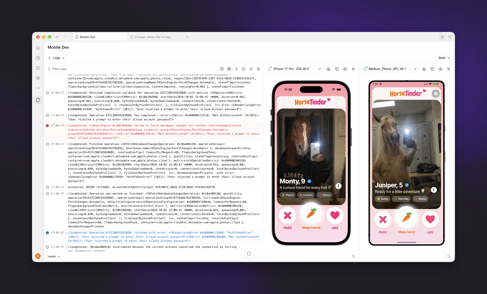
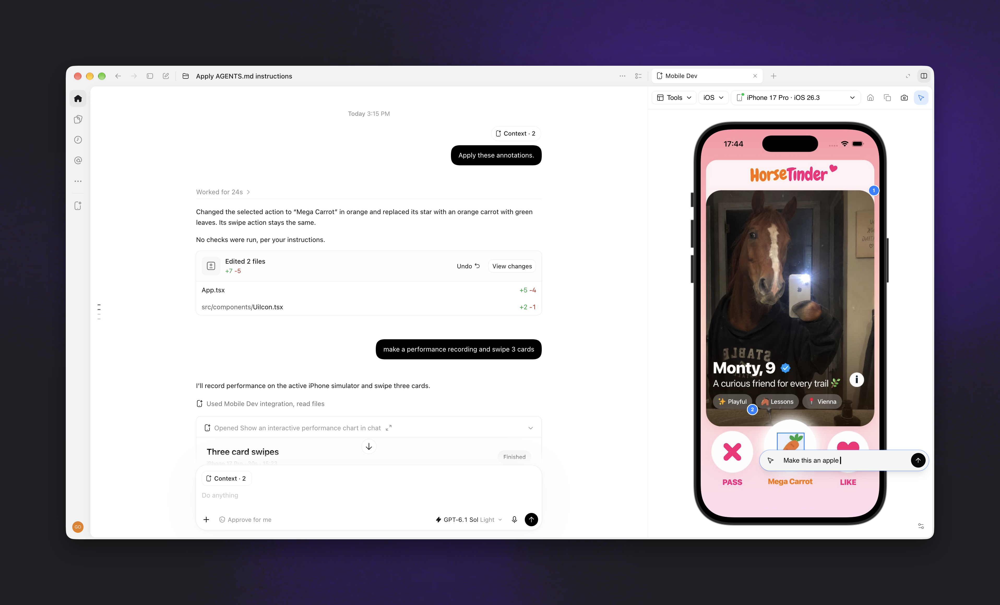
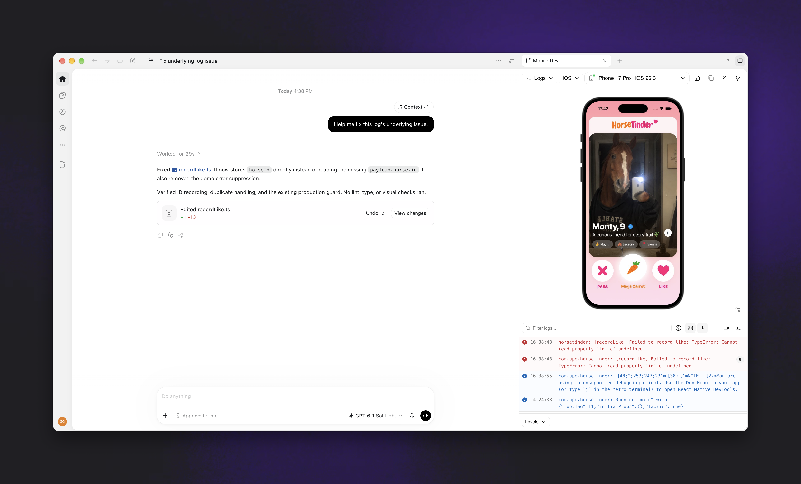
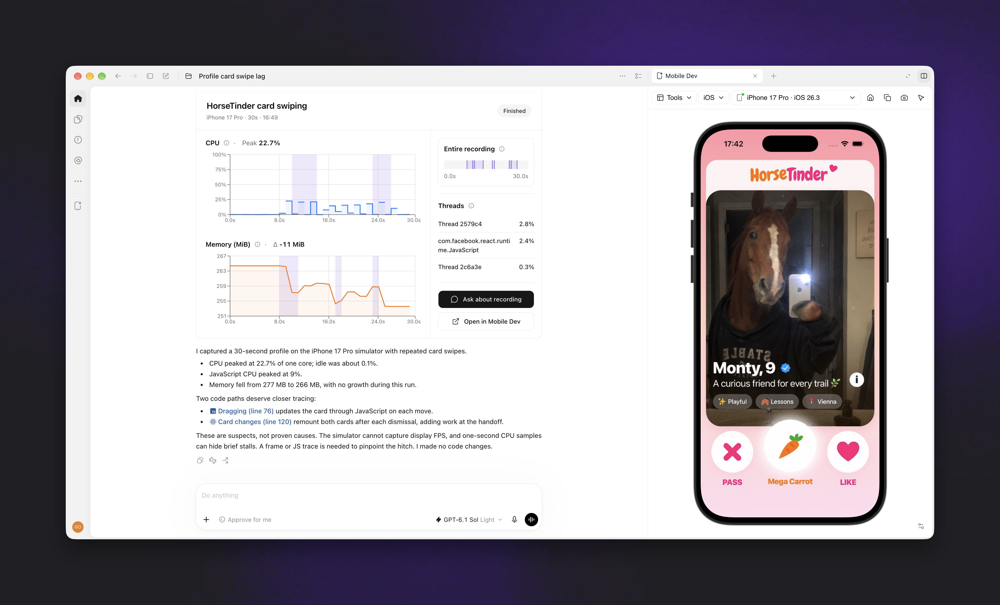

<p align="center">
  <a href="https://incubator.callstack.com/codex-mobile-dev-plugin/">
    
  </a>
</p>

## Features

### Live devices beside your chat
Stream iOS simulators, Android emulators, and connected iPhones, iPads, and Android devices. Show iOS and Android together or use the fullscreen workspace.



### Device control, inspection and annotations
Select and boot simulators or emulators, interact with taps and drags, type on supported devices, and let your agent inspect accessibility elements and control your app through the bundled [agent-device](https://agent-device.dev/) runtime. Select an element or screen region and leave instructions for your agent, with React Native component and source details when available.



### App control
Install a built app, launch or stop it, and open a deep link or URL to jump to a screen. Send a test push notification to an iOS simulator app. Allow, deny, or reset an app permission without the system prompt, and run an app in another language than the device. The app tools in each device panel launch and stop apps, open URLs, send pushes, and set permissions and language; the agent can also call every action as an MCP tool. Mobile Dev does not build your app; your project's own tools do.

### Device settings and network conditions
Change the running device's appearance, text size, rotation, location, and status bar without restarting its stream. Switch the network to LTE, 3G, Edge, or Offline to see how the app behaves on a slow or missing connection, then back to Normal. Available settings depend on the platform and device kind.

### App Flow
Build a visual map of your app's screens and the navigation between them, for Expo Router and React Navigation projects. **Structure only** reads the navigation out of your source in seconds and needs no device; **Screen UI + Structure** also walks the app on an iOS simulator and photographs every screen it reaches, optionally opening each screen's sheets, modals, and dialogs. The walk runs your project's own `ios` script and reaches each screen through in-app navigation, a deep link, or a path you recorded; record one by hand on the live wireframe for a screen it cannot reach. Explore with AI lists the screens the deterministic pass missed and retries only the ones you pick. Maps, captures, and recorded paths are stored per project under `~/Library/Application Support/mobile-dev/app-flow`.

### App Intelligence
Trace each Expo Router or React Navigation screen through the source files, assets, and packages it depends on, without building or running the app. Choose a project and generate its static iOS and Android graph, then browse entry points by area, fold or highlight dependency groups, and see which dependencies are platform-specific. Ask your agent what a screen depends on, which screens reach a file, or to show one screen's graph. Saved snapshots live under `~/Library/Application Support/mobile-dev/app-intelligence`; project paths and graph contents are excluded from Sentry telemetry.

### Native and JavaScript logs
Read iOS unified logs, Android logcat, and Metro console messages together. Follow the foreground app, search and filter logs, and send an error and its stack trace to chat.



### Live performance monitoring and improvements
Track app CPU and memory, expand individual thread charts, and view device-wide Display FPS on supported devices. Ask your agent to record an interaction, inspect interactive charts in chat, compare runs, and analyze selected ranges. Android recordings include display frame pacing and jank statistics.



### Profile analysis with TraceSift
Analyze a local CPU profile or a React DevTools profiling export with TraceSift. The findings appear as cards in chat, each splitting a measured task between the features it entered. Explore opens the full call tree, timeline, and flame graph in the card. Select frames or components there and ask the agent to investigate them, with the measured evidence attached. The TraceSift tool in the device panel uploads a profile and keeps the source folder an investigation should land in.

### App storage
See what an app has saved without adding code to it, whether it is built with React Native or natively: UserDefaults and App Group containers, Core Data and SwiftData, SharedPreferences, DataStore, MMKV, AsyncStorage, SQLite databases, and the largest files in its data directory. Open SQLite tables as a paged grid, open any file to see JSON, property lists, and archives decoded, search across every store at once, and open the Changes tab to watch keys being added, changed, and removed while you use the app, with only the changed part of JSON values highlighted. SDK data from Firebase, Google Analytics and similar libraries is grouped separately. Clear one store or reset all app data. Works on iOS simulators and debuggable Android builds; MMKV value types are guessed from the stored bytes, and encrypted MMKV instances show as locked.


Storage results are filtered before reaching the host or panel. Recognized sensitive
fields and credential-like values show `[REDACTED]`; binary values are withheld.
Ask for a specific store/key or table/columns to narrow inspection. This filtering
cannot identify all personal or confidential data; use synthetic development data.
See [storage privacy and review checks](docs/storage-privacy.md).

## Install

### Codex

**[Add Mobile Dev to Codex](https://chatgpt.com/plugins/plugins_6ac4c117f76881918d3676e851fa4005)**
from the plugin directory, then open a new chat.

To install the prebuilt plugin from this repository instead, see
[Install from the GitHub marketplace](CONTRIBUTING.md#install-from-the-github-marketplace).

### Claude Code and Claude Desktop

In Claude Code, ask to see a device and Claude opens Mobile Dev's device panel in its
browser beside the chat, such as the Claude desktop app's built-in browser pane. The
first open downloads the panel's runtime (Baguette, Android streaming and iPhone
mirroring) once from this repository's GitHub release, checked against the checksum
the plugin pins. Claude reads the devices you select in the panel and anything you add
to chat from it. Mobile Dev also adds device control through the bundled
[agent-device](https://agent-device.dev/) runtime, native
and Metro logs, app control and storage, interactive CPU, memory and FPS charts in
chat, and TraceSift findings.

On an Apple Silicon Mac with Node.js 22.19 or later, install the Claude Code plugin
from this repository's `release/claude` branch. It finds Node on `PATH` or where
Homebrew, nvm, fnm, Nix, Volta, mise or asdf install it, and Claude tells you at the start
of a session when none is found:

```sh
claude plugin marketplace add https://github.com/callstackincubator/mobile-dev.git#release/claude
claude plugin install mobile-dev@mobile-dev
```

Or in a session, `/plugin install mobile-dev --marketplace https://github.com/callstackincubator/mobile-dev.git#release/claude`.
Run `claude plugin marketplace update mobile-dev` to update.

For Claude Desktop chats, download `mobile-dev-<version>-claude-desktop-darwin-arm64.mcpb`
from the [latest release](https://github.com/callstackincubator/mobile-dev/releases/latest),
open **Settings > Extensions > Advanced settings**, and under **Extension Developer**
click **Install Extension…** and select the file, or open it with Claude Desktop.
Claude supplies Node for the bundle. Install a newer `.mcpb` to update. Use either
the plugin or bundle, or the [local development connection](CONTRIBUTING.md#claude-desktop-local-development),
to avoid duplicate Mobile Dev servers.

What the Claude version runs on your Mac, besides its Node.js server:

- **agent-device**, its bundled Node.js runtime, for device control. On first iOS
  use it builds its XCTest runner from the included source with your Xcode and
  caches it in `~/.agent-device/apple-runner`; it keeps session state and logs in
  a temporary directory.
- **Native helpers** for logs and measurements: a physical iPhone log reader built
  on libimobiledevice, an iOS FPS and foreground-app reader, and Android CPU and
  FPS collectors that it copies to a connected Android device with `adb` and runs
  there.
- **Developer tools** already on your Mac: `xcrun simctl`, `devicectl`, `adb`, and
  the Android emulator, and TraceSift when you analyze a profile.
- **A Node.js launcher and a session check** in the Claude Code plugin, which find
  Node.js and start the server.

It sends plugin errors and aggregate measurements to Sentry, as described under
[Privacy and support](#privacy-and-support), and nothing else to Callstack;
profiles go only to the TraceSift service on your Mac.

### T3 Code

[T3 Code](https://github.com/pingdotgg/t3code) runs Claude Code and Codex, so it loads
the Mobile Dev plugin that each of them has installed. On the Mac that runs T3 Code,
install the [Claude Code plugin](#claude-code-and-claude-desktop) for Claude threads
and the [Codex plugin](#codex) for Codex threads. In both, the panel opens in T3 Code's
Browser.

Turn off T3 Code's own device integration while you use Mobile Dev. In
**Settings → Devices**, turn off **Use devices**, which also turns off **Agents can use
devices**. Otherwise T3 Code gives agents its own `device_*` tools, with the same names
as Mobile Dev's, and tells them to prefer those tools.

Codex threads need one setting, because T3 Code renders Codex's panel in the chat
and asks you to confirm each action that the panel takes, such as each tap:

1. Open **Settings → Providers**, then the Codex instance.
2. Under **Variables**, click **Add variable**. Set `MOBILE_DEV_PANEL` to `browser`.
3. Start a new thread.

Ask the agent to open Mobile Dev. It opens the panel with T3 Code's `preview_open`
tool, and T3 Code shows the page as a floating preview. To dock the panel beside the
chat, click the preview's **Open in right panel** button. The agent reads the devices
you select in the panel and the screenshots and screen notes you add from it.
Performance recordings still render as cards in the chat.

### Cursor: manual installation

On an Apple Silicon Mac with Node.js 22.19 or later on `PATH`, obtain the
`mobile-dev` Cursor plugin folder from the person sharing the preview, or
[build one locally](CONTRIBUTING.md#cursor-local-development). The Cursor plugin is
not yet published to the Cursor Marketplace.

1. Copy the `mobile-dev` folder to `~/.cursor/plugins/local/mobile-dev`.
2. Run **Developer: Reload Window**, or restart Cursor, and confirm Mobile Dev
   appears under **Customize**.
3. Start a new agent chat and ask **"Open Mobile Dev."** Approve the tool calls
   when prompted.

Cursor renders the Mobile Dev views where MCP Apps are available. Otherwise tools
return text, and the agent asks you to choose devices in chat. Copy a newer folder
and reload to update. Use either the plugin or the [local development connection](CONTRIBUTING.md#cursor-local-development)
to avoid duplicate Mobile Dev servers. See [Cursor's plugin guide](https://cursor.com/docs/plugins).

### Mac app

The Mac app shows the devices and tools in their own window, without a chat. Pick
a tool and the visible platforms in the sidebar. It runs the same server as the
plugins, so the device panels, logs, performance, storage, and TraceSift work the
same way. Chat actions such as Send to chat and annotations are hidden because
there is no chat to send to.

There is no download yet. Build it from a checkout on an Apple Silicon Mac with
Xcode 27, following [the Mac app guide](CONTRIBUTING.md#mac-app):

```sh
npm ci
npm run build
npm run build:mac
open "release/mac/Mobile Dev.app"
```

## Requirements

Mobile Dev runs on an Apple Silicon Mac. In Codex desktop, the prebuilt plugin
uses Codex's bundled Node runtime from its workspace dependency cache; the Claude
Desktop bundle uses Claude's Node runtime, the Cursor plugin uses Node.js from
`PATH`, and the Mac app bundles its own. Install the tools for the platforms you use:

| Platform or feature | Requirements |
| --- | --- |
| iOS simulators | Xcode 26 or later with an installed simulator runtime. |
| Physical iPhones and iPads | Xcode 27 or later, a paired device with Developer Mode enabled, and USB or Wi-Fi connectivity. Screen mirroring requires HEVC WebCodecs support in the host. |
| Android | Android SDK platform-tools and emulator, and an AVD or a physical device with authorized USB or wireless debugging. Screen streaming requires H.264 WebCodecs support in the host. |
| Metro logs and React Native inspection | An existing local Metro server with a compatible app inspector target. |
| Physical iOS CPU and memory | iOS 17.4 or later, a running development-signed app with `get-task-allow`, a mounted developer disk image, and Xcode/LLDB detached. |
| Display FPS | Android 12 or later with FrameTimeline support, or a physical iOS device running iOS 17.4 or later. iOS simulators do not support Display FPS. |
| Profile analysis | A local TraceSift installation, found on `PATH` or through `TRACE_SIFT_COMMAND`. |

Simulator tools use the full Xcode installation selected by `xcode-select` (or
`DEVELOPER_DIR`), including its Swift compatibility libraries. Custom Xcode names
and locations are supported. If Command Line Tools or an older Xcode is selected,
choose Xcode 26 or later in Xcode Settings > Locations > Command Line Tools.

The app project's own tools build, install, and launch your app. Mobile Dev supplies
its device panel, inspection, logs, and performance tools.

## Get started

Ask your agent to open the simulator beside this chat. In Codex, you can also
open Mobile Dev from the sidebar; in Cursor, ask **"Open Mobile Dev"** in an agent chat.
Pick a device from the toolbar; selecting a stopped simulator or AVD
boots it. Use the iOS and Android toggles to show either platform or both.

Click an iOS simulator or Android screen to focus it, then press **Command-V** to
paste text into the device. Paste accepts up to 4,096 printable US-ASCII characters;
line breaks and other characters show a notice without sending partial text.

Ask your agent to work with your app, for example:

- “Build and run my Expo app in the simulator beside this chat.”
- “Read the app logs and help me fix this error.”
- “Record CPU and memory for 30 seconds while I scroll checkout.”
- “Compare these two performance recordings.”
- “Show me the App Intelligence for this project.”

Open App Intelligence, Logs, Performance, Storage, or TraceSift. App Intelligence analyzes a project without a device; the other tools inspect the selected device. Use Screenshot to attach
an image to your next message, or Select to annotate an element or region with an
instruction. Physical iOS supports taps and drags; keyboard and hardware-button
controls are unavailable.

## Documentation and contributing

Detailed guides are available for
[devices](https://github.com/callstackincubator/mobile-dev/blob/main/docs/devices.md),
[logs](https://github.com/callstackincubator/mobile-dev/blob/main/docs/logs.md),
[performance](https://github.com/callstackincubator/mobile-dev/blob/main/docs/performance.md),
[App Intelligence](https://incubator.callstack.com/codex-mobile-dev-plugin/docs/app-intelligence),
and [MCP tools](https://github.com/callstackincubator/mobile-dev/blob/main/docs/mcp-tools.md).
[Architecture](https://github.com/callstackincubator/mobile-dev/blob/main/docs/architecture.md) explains how the hosts share the server
and panel.

The repository is an npm workspace. Shared code lives in `packages/`, and each
product in `apps/`:

| Path | Contents |
| --- | --- |
| `packages/core` | The MCP server, device runtimes, and tool handlers |
| `packages/ui` | The device panels and tools every host shows |
| `packages/mcp-app` | The MCP Apps panel that Codex and Claude Desktop load |
| `packages/shared` | Types and logic the server and UI both use |
| `packages/skills` | Agent skills for the shared tools |
| `packages/native`, `packages/runtimes` | Native helpers and bundled Node runtimes |
| `apps/codex-plugin` | The Codex plugin: manifest, updater, and update banner |
| `apps/claude` | Claude: its server, which downloads the panel's runtime, skill, and the Claude Desktop extension and Claude Code plugin manifests |
| `apps/cursor` | Cursor: the Cursor plugin manifest |
| `apps/mac` | The Mac app: SwiftUI window and its page |

To build a host, install a local package, or contribute changes, see
[CONTRIBUTING.md](https://github.com/callstackincubator/mobile-dev/blob/main/CONTRIBUTING.md).
Implementation and release details live in the linked contributor documentation.

## Privacy and support

Mobile Dev reports plugin errors, crashes, usage counters, sampled traces, and
aggregate plugin performance measurements to Sentry by default. App logs,
screenshots, input content, tool payloads, app storage contents, profiles, and
device performance recordings are excluded from that telemetry. Errors and
crashes use a randomly generated persistent installation ID. Set
`MOBILE_DEV_TELEMETRY=off` in the MCP launch environment and restart the plugin
processes to disable reporting. For the Mac app, start it with
`open --env MOBILE_DEV_TELEMETRY=off "Mobile Dev.app"`. Tool results and content sent to chat are handled
by the host separately. Read the [Privacy Policy](PRIVACY.md) and
[Terms of Service](TERMS.md), or see
[Sentry observability](https://github.com/callstackincubator/mobile-dev/blob/main/docs/telemetry.md)
for implementation details.

For help, email [hello@callstack.com](mailto:hello@callstack.com).
See [Support](SUPPORT.md) for reporting bugs, security issues, and privacy requests.

## License

Mobile Dev is available under the [MIT License](LICENSE). Bundled third-party
components keep their own licenses; see [Third-party notices](THIRD_PARTY_NOTICES.md).
