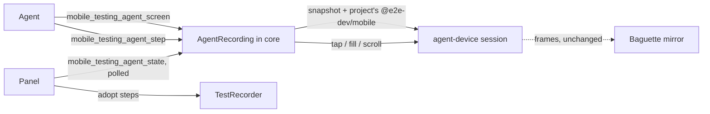

# Agent-driven recording in the Testing panel

Status: implemented. The five model tools, `mobile_testing_agent_state` and
`mobile_testing_set_context` are in `packages/core/src/testing-agent.ts`; the panel polls, adopts
and locks the mirror; the skill is `packages/skills/mobile-dev-testing`. Android emulators are supported
through the context's `deviceId` and `platform`; physical devices, Maestro, saving and running are
still out, as below.

The Testing panel records an e2e test from the user's own taps on the mirror
([docs/testing-panel.md](testing-panel.md)). This adds the other driver: the user tells their
coding agent *"use Mobile Dev and record the test for the important areas on the Explore Details
screen"*, the Testing tab opens, and the steps appear in it one at a time as the agent works. When
the agent stops, the flow is sitting in the panel unsaved and the user adjusts it, saves it and
runs it exactly as if they had tapped it themselves.

## Decisions

| Decision | Choice | Why |
|---|---|---|
| Who reasons | The user's own agent, one step per tool call | No model in the server, no second set of credentials, the agent already has the mobile-dev skill and can see the mirror |
| Panel | Live — steps appear as they are recorded | "Opens up the panel for the user" is the point; it also gives the user a Stop button |
| Step kind | Pinned locators; `agent.act`/`agent.assert` only where nothing resolves | Same rule the manual recorder follows: the point of recording is determinism |
| Saving | No. The agent finishes with the steps dirty in the panel | The user adjusts before anything reaches `tests/` |
| Keeping | Yes, as an unsaved recording in the plugin's own storage | Nothing reaches `tests/`, and a flow the user has not opened the panel for yet is not lost — see [docs/testing-panel.md](testing-panel.md#unsaved-recordings) |
| Running | No | There is no file to run, and a run resets the app and takes the device session |
| Prerequisites | Refuse when no project or device is chosen | Project choice stays the user's explicit act, and an OS folder picker must not open inside an agent turn |

Out of the first pass: physical devices, Maestro, saving, running, and any agent in the
server process.

## Why the server has to own the session

The recorder is a singleton in the iframe (`testRecorder`, `packages/ui/src/test-recorder.ts`);
`RecordedStep[]` exists nowhere else. The agent talks to the server over MCP and cannot reach that
object. The only point the two share is the server process, so the agent's recording lives there
and the panel reads it — the same shape as run progress, which the panel already polls because a
tool call is one request and one response.

## The tools

New file `packages/core/src/testing-agent.ts`, registered beside `registerTestingTools`.

Model-visible (`_meta.ui.visibility: ["app", "model"]`, the `sharedVisibility` shape already used
in `packages/core/src/app-flow-tools.ts`):

| Tool | Input | Does |
|---|---|---|
| `mobile_testing_agent_begin` | `{ title, goal }` | Opens the Testing tab, starts one session against the panel's current project, device and bundle id. Refuses, with what is missing, when any of the three is unset. |
| `mobile_testing_agent_screen` | `{}` | The runner's element tree as the agent's eyes: one compact row per element — `ref`, `role`, `name`, `text`, `placeholder`, `value`, `testId`, `enabled`, `selected`, `bounds` — **and the selector the recorder would emit for it**, with its rank and whether it is unique. The agent never writes a locator; it names a `ref`. |
| `mobile_testing_agent_step` | `{ ref?, kind, value?, direction?, instruction? }` | Records one step and performs it. `kind` is a `PinnedStepKind`; `instruction` with no `ref` records an `AgentStep`. Assertions record without touching the device, mirroring the element menu. An acting step answers with `navigated: true` when it replaced the screen — see "Where a flow ends". |
| `mobile_testing_agent_finish` | `{ note? }` | Ends the session with the steps left dirty in the panel. Saves nothing, runs nothing, and keeps the device session for the panel's recorder. |
| `mobile_testing_agent_abort` | `{ reason }` | Drops the session; whatever was recorded stays in the panel. |

App-only:

| Tool | Input | Does |
|---|---|---|
| `mobile_testing_agent_state` | `{}` | `{ active, status, revision, title, goal, steps, note, error }`. The panel polls it. |
| `mobile_testing_set_context` | `{ projectPath, udid, bundleId }` | The panel reports its selection whenever it changes. This is the only thing that knows the selected device, and `agent_begin` reads it. |

The eight existing `mobile_testing_*` tools stay app-only. A narrow, intention-shaped surface is
what keeps `write_file` and `run_test` out of the model's hands, which is what
`packages/core/src/testing-tools.ts:17` already says.

One session at a time. A second `agent_begin` refuses rather than stomping on the first.

## Where a flow ends

The first thing a real user asked for was *"record the test for the important areas on the Explore
screen"*. The recording covered Explore, tapped through to Explore List, and then kept going:
`Explore Cities` asserted, `Spending summary` asserted, the `Search transactions` field filled.
None of that is the Explore screen.

Nothing had said so. The skill said where a flow *starts* — "the navigation to the screen is part
of the flow" — and a starting point is what the agent read the screen name as. So the skill now
says where one **ends**: the named screen is the *scope*, a control that leaves it may be tapped
and the arrival asserted once, and then the recording stops. A *flow* name ("the checkout flow")
is not a boundary; a screen name is.

The tool surface helps, because the skill alone is a rule with nothing to apply it to: a screen
read answers with elements, not with screen identity. So an acting step now answers with
**`navigated: true`** when it replaced the screen, and carries the session's own `goal` sentence
back with it, which is the thing the agent has to weigh the new screen against.

- The signal is the **overlap between the two reads' element identities** — role, testID, name,
  text, which are what a test names an element by and are stable across reads, where node ids are
  minted per read. A step that *changes* a screen leaves most of it in place; a step that
  *navigates* replaces it. Measured on a real app: opening a disclosure kept every element,
  switching tabs kept about two fifths of them — the tab bar and the chrome around it — and
  tapping into a pushed screen kept about a tenth. The threshold is a third, in the gap between
  those. A tab switch not firing is the answer worth having: it is usually the navigation *to* the
  screen the recording is for, so a boundary warning there would land exactly as the agent
  arrives.
- The extra read costs nothing. An acting step needed one anyway to compare, and that read is the
  one the agent's next `mobile_testing_agent_screen` is served from, so the loop still pays one
  snapshot per step.
- **It is a hint, not a gate.** Nothing refuses a step, nothing counts navigations, and
  `agent_begin` has no scope limit. A checkout and a sign-in cross screens on purpose, and a
  recorder that would not let them is worse than one that occasionally records a step too many.

## Reusing what is there

- **Selector resolution and emission are already pure** and already in
  `packages/shared/src/test-recording.ts`: `resolveSelector`, `stepOffers`, `stepExpression`,
  `emitE2eTestLines`. Core imports them. Nothing is reimplemented and nothing is duplicated, so an
  agent-recorded step and a hand-recorded one are the same `RecordedStep` and emit the same line.
  The one change needed: resolution is reached today through `hitLadder`, which starts from a
  point. The agent starts from an element, so the element-shaped entry point is factored out and
  the point path calls it.
- **Reading** goes through the existing `TestingDevices.read` — `capture.snapshot` projected by the
  project's own `@e2e-dev/mobile`, on the `mobile-dev-recorder` session.
- **Acting** is new: `TestingDevices.perform({ ref, kind, value })` on that same session, through
  agent-device's own tap/fill/scroll. Not the panel's baguette input path — the server cannot reach
  it, and agent-device taps the element the way the runner will. The mirror still shows every
  change, because the stream and the snapshot already hold the simulator at once.
  This means each projected node must keep its agent-device node beside it so a `ref` maps back.
- **The device is released** on the paths that already release it. An agent session is one more
  holder of the same `mobile-dev-recorder` session, not a second one.

## The panel

`TestingPanel` polls `mobile_testing_agent_state` — 400 ms while a session is active, a slow tick
otherwise so a session the agent started is noticed.

- On a revision bump, `TestRecorder.adopt(steps)` replaces the step list. The preview's existing
  `changedLines` animation flashes the new lines, so a step the agent records reads the same as a
  step the user records.
- `recordingUdid` is set for the agent's device, so the step list, the emitter, editing,
  duplication and Save all work unchanged. This is deliberately not a second state machine.
- While a session is active: a banner reads **Agent is recording — <goal>** with a **Stop** button
  that calls `agent_abort`; left-click drive and the right-click element menu on the mirror are
  disabled, because the agent and the user must not both be acting on one screen.
- On `finished`: the banner clears, the steps stay dirty, and the panel says what was recorded and
  that nothing has been saved. From here it is an ordinary unsaved recording. The server has kept the
  flow by then and `agent_state` carries its `draftId`, which the panel adopts so its own autosave
  replaces that draft rather than leaving a second copy of one recording in the list.

## The skill

A new skill, `packages/skills/mobile-dev-testing/`, shipped the way `packages/skills/README.md`
describes: all three plugins for Codex and Cursor, and `apps/claude/skills` for Claude Code.

It covers:
- **When**: the user asks to record, write or capture an e2e test for a screen or a flow.
- **Prerequisites**: the Testing tab, a chosen project, a booted iOS simulator with the app
  launched. Missing any, say which and ask — never open the folder picker on the user's behalf.
- **The loop**: `agent_begin` → `agent_screen` → choose a `ref` → `agent_step` → re-read → … →
  `agent_finish`.
- **What to record**: the test starts from `app.open()`, so the navigation to the target screen is
  part of the flow and is recorded. Then the screen's landmarks as assertions, its one or two real
  affordances exercised, and the result asserted. Keep a flow under about fifteen steps; a long
  flow is two tests.
- **Pinned first.** Use `agent.act`/`agent.assert` only for a `ref` the screen read reports as
  having no unique selector.
- **Never save and never run.** Finish and tell the user the flow is in the panel to adjust.

## Telemetry

Per [AGENTS.md](../AGENTS.md): count `ui.testing.agent_session_start`, `agent_step_adopted` and
`agent_session_abort`; time the server's screen read and the panel's adopt-to-render. Failures go
through `captureServerError` / `captureUiError`. The goal sentence and element names are user
content and are **not** sent — only counts and durations. Document the new names in
[docs/telemetry.md](telemetry.md).

## Build order

1. Element-shaped selector resolution factored out of the point path, plus
   `TestingDevices.perform` and the ref↔node mapping. Tests in
   `packages/shared/test/test-recording.test.ts` and `packages/core/test/testing-device.test.ts`.
2. `testing-agent.ts`: the session, the five model tools, `mobile_testing_set_context`,
   `mobile_testing_agent_state`. Provable with the tools alone, before any UI.
   `packages/core/test/testing-agent.test.ts`.
3. The panel: the poll, `TestRecorder.adopt`, the banner, the input lockout and the handover.
   `packages/ui/test/test-recorder.test.ts`, `packages/core/test/testing-panel-ui.test.ts`, and
   refreshed visuals via `npm run test:visual:docker -- --update-snapshots`.
4. The skill, `docs/telemetry.md`, and this document's status line.
5. Prove it against `/Users/hurali/Desktop/callstack/test-projects/expoapp57`: *"record the test for
   the important areas on Explore Details"*, which should navigate Explore → Explore List → Paris,
   assert the heatmap and its description, fill "Search reviews" and assert the filtered review row
   — roughly `tests/city-review-search.e2e.ts`, which a human recorded by hand.

## What the real device changed

Five things in the plan did not survive contact with a booted iPhone and the project's own runner,
and each was adjusted rather than forced.

- **The ancestor chain stops below the screen's own root.** The point path never reaches a
  full-screen root because `hitLadder` drops one; an element-shaped chain walks `parentId` up and
  reached it on every unnameable node, so a scroll bar resolved to `screen.getByText("expoapp57")`
  and the read reported it *unique*. `resolveComponentSelector` now takes the viewport and applies
  the same rule. `anchorSelector` had the same latent bug — the root is the nearest element to any
  point — and now takes it too, so a coordinate step no longer waits for the application to exist.
- **Every action settles.** The step after one is resolved against the screen it produced, and
  agent-device refuses an action on a ref it captured mid-transition: *"had no confirmed resting
  position when the transition window ran out"*. The wait belongs where the transition is, so
  `perform` passes `settle: true` rather than leaving the next read to guess.
- **A viewport swipe is agent-device's `scroll`, not a trajectory of ours.** Deriving one from the
  snapshot's viewport is refused with *"Gesture trajectory does not fit inside the viewport"* the
  moment the on-screen keyboard shrinks the window the gesture runtime measures. The runner
  performs `screen.swipe` as `client.interactions.scroll({ direction })`
  (`@e2e-dev/mobile/dist/surface.js`), so the recorder does the same call with the same direction.
  It also stopped carrying the coordinate-tap TODO, which was never true of it, while keeping the
  anchor gate, which is.
- **Off-screen elements stay in the read, flagged `offScreen`.** The first version dropped them as
  the mirror does, and the flow being recorded was a search filter whose *result* is a row below
  the fold. `getByText` resolves it either way, so dropping it hid exactly what the test was being
  written about.
- **agent-device's refs keep their `@`.** `@e2e-dev/mobile`'s projection strips the sigil for its
  own use and `interactions.click({ ref: "e20" })` then parses the ref as a selector and refuses
  it. It is put back at the one boundary that hands a ref to agent-device.

Two smaller departures from the text above: the panel **releases the device** when an agent
recording ends, exactly as the Stop button does, because a leaked `mobile-dev-recorder` session is
the failure `docs/testing-panel.md` spends a section on and Record re-attaches in a tenth of a
second; and the panel **restores the last project when the host becomes available** rather than
only when the tab is opened, so an agent recording does not require the user to open the tab first
only to have it reopen on the folder they already chose.

### Proved against expoapp57

Driving the five tools from outside the panel, one step per call, against a booted iPhone 17 Pro
produced `tests/agent-explore-details.e2e.ts` in that project — Explore → Explore List → Paris, the
heatmap and its description asserted, "Search reviews" filled, the value and the featured reviewer
asserted, and back — and the project's own `e2e run` passes it. The one assertion the hand-recorded
`tests/city-review-search.e2e.ts` has and this does not is the filtered review row: with the
keyboard up it is past the end of the scroll content and never enters the snapshot, so the agent
could not read the text it would have asserted. It asserts what it can see, which is the rule the
skill states.

## Risks

- **Ref staleness.** A step must act on the element it resolved. Every action invalidates the tree,
  as the manual recorder already assumes, so the agent re-reads after each one and a `ref` from an
  older read is refused rather than acted on.
- **Cost.** A screen read is about 0.1 s and a flow is ten to twenty of them. Acceptable; the
  manual recorder pays the same per tap.
- **Two drivers, one screen.** Solved by locking the mirror's input while a session is active, not
  by hoping.
