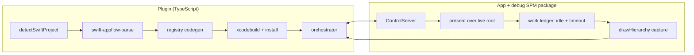
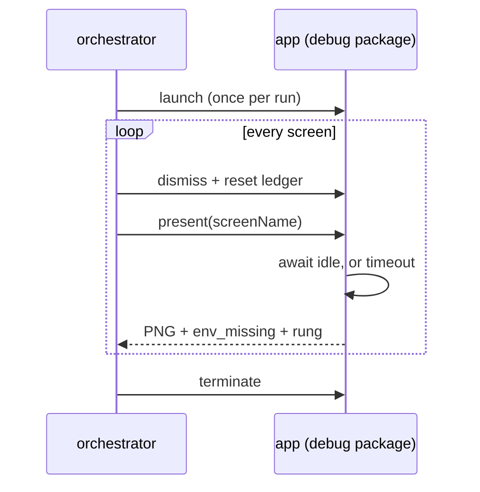

# SwiftUI app-flow — POC plan

Extends app-flow (today: React Native / Expo) to map the screens of **SwiftUI**
apps. Jetpack Compose is out of scope; UIKit is a later iteration.

## Agreed scope (unchanged)

| Dimension | Decision |
|---|---|
| Capture mode | **Fast only.** No deep-link mode, no exploration mode. |
| Instrumentation | Opt-in **debug SPM package**. No per-screen source changes. |
| App access | Xcode project in the workspace (source present, buildable). |
| Screen identity | Swift view type name (e.g. `ProfileView`). |
| Milestone | Structure + UI (screenshots). |
| Codegen | Acceptable. Working POC first, DevExp after. |
| Mocked data | Fine. `ProfileView()` or `ProfileView(user:)` — one, not both. |
| Unpresentable routes | Recorded as "what's missing" and left, as RN does. |
| Registry file | Gitignored. |
| UI states | Ignored for now. |
| Session-recording corpus | Deferred. |

**Guiding rule:** a value is only ever observed, never invented. A screen we
refuse to construct is a correct answer; a screen built from a fabricated value
renders a lie.

## Corrections to what was built

Three things drifted past the agreed boundary during the design iterations and
are being **removed**, not demoted to opt-in.

| Removed | Why it drifted | Replacement |
|---|---|---|
| `.captureReady(_:)` + `CaptureReadyKey` (`Harness.swift:31,42,555`, 13 call sites in `Screens.swift`) | The readiness brief priced *correctness* only, so the search walked into the app. `ready` was the only cheap 13/13. | **Work ledger (`idle`) + timeout backstop**, both inside the package. **13/13** correct once the reset changed too, zero source changes. |
| `CaptureResettable` / `CaptureStores` (`Domain.swift:45,52`; 4 store conformances) | Same family — requires app types to conform. Introduced to fix capture-to-capture state leak. | **Relaunch per screen.** Re-measured 594–614 ms over 8 runs. A fresh process cannot leak, and it gives crash isolation for free. |
| `Rung.synthesized` (`Model.swift:62`, `main.swift:322,335,343`) | A plain non-`Binding` parameter given a made-up value — a direct breach of observed-never-invented. | Plain param with no observed value → **`skipped`**, with the type recorded in `missing`. Costs **0 screens**: the rung resolved to 0 across all three corpus apps. |

`neutralSynthesis` **stays for `Binding` parameters only**. A `Binding` has no
observed value by nature; supplying one is structural, and the `bindingsOnly`
rung already covered it.

### Why `idle` is enough

Measured on iPhone 17 Pro / iOS 26.2, 13 screens, 3 runs, ground truth = 4 s-settled capture.

| Signal | Correct | Cost | Source changes |
|---|---|---|---|
| `frame` | 10/13 | 64–83 ms | none |
| `stable` (pixel quiet window) | 10/13 | 350–401 ms | none |
| **`idle` (work ledger)** | **13/13** | **250–2901 ms** | **none** |
| `timeout` (flat settle) | 13/13 | 4001 ms | none |
| ~~`ready`~~ | ~~13/13~~ | — | per-screen |

**Re-measured after the removals** (same device, same metric, `results/`
overwritten). `idle` went from 12/13 to 13/13, and the reason is worth keeping:
its one miss was `TwoStageOrderView`, and it was caused by the *in-process
reset that is also being removed*. `CaptureResettable` bumped each store's
epoch, and `TwoStageOrderStore` only calls `WorkTracker.begin` for its second
stage inside a completion guarded by that epoch — so the reset dropped the
continuation and the ledger never learned the items fetch was pending. `idle`
fired at 1050 ms, mid-fetch. With a relaunch as the reset, both stages are
tracked and `idle` fires at 1800 ms, after stage 3, on every run.

So the screen is still adversarial by construction — static for 1.25 s, then it
mutates — but a work ledger that *sees* the pending work is right about it. The
earlier 12/13 measured the harness, not the signal.

### The readiness default, re-decided against a real app

The table above is the demo corpus, and it does not transfer unexamined. Measured on
IceCubesApp (42 registry screens, 38 presented, logged out):

| | demo, 13 screens | IceCubesApp, 38 screens |
|---|---|---|
| `peak_outstanding > 0` | most screens | **0 of 38** |
| `idle` fires | 13/13 | **12/38** |
| `stable` fires | 13/13, 10 correct | 38/38 |

Two things follow.

**The work ledger is inert on an unannotated app.** Nothing in IceCubesApp calls
`WorkTracker.begin`, so `idle` there is the animation check and nothing else. The demo's
13/13 is carried by the ledger, which a real app will not have. That is a property of the
corpus, not of the signal, and it has to be said plainly wherever the 13/13 is quoted.

**`stable` is not the fallback it appears to be.** On IceCubesApp it fires on every screen,
including all nine data-backed lists, at 459–1060 ms. The capture it produces for
`TrendingLinksListView` is a frame reading "Loading ...". It is not succeeding where `idle`
fails; it is failing in the way the demo corpus already found it fails, on a corpus where
nothing can catch it, because logged out no screen ever finishes loading and there is no
ground truth to compare against.

**What was actually wrong with `idle`** was `hasRunningAnimation`, which treated any
animation key as "still busy". On iOS 26 that is close to permanently true. The animations
blocking it are three unlike things:

| form | example | meaning |
|---|---|---|
| `duration == .infinity`, `rep = 0` | `CASDFElementLayer:match-*`, `_UILiquidLensView.punchout` | Liquid Glass; a held state |
| finite `duration`, repeating forever | `ProgressView` spinner, redaction shimmer | **not ready** |
| finite `duration`, re-added each cycle | `CAReplicatorLayer:instanceAlphaOffset` | **not ready** |

Only the first can be ignored. The obvious rule — ignore anything that repeats forever —
is wrong, and the demo corpus catches it: `RemoteAvatarView` shows a `ProgressView` while
its `AsyncImage` loads, so ignoring forever-repeats fired `idle` at 252 ms onto a
half-loaded screen and took 13/13 to 12/13. Nothing in a `CAAnimation` separates a spinner
from a decorative logo. An infinite `duration` is separable, because it is not a cycle at
all.

So readiness ignores animations with an infinite `duration` and waits for everything else,
with the flat backstop bounding the cost. The asymmetry is deliberate: capturing early
produces a wrong screenshot that looks right, while waiting too long is only slow.

Re-measured under that rule, within one run:

| | demo | IceCubesApp |
|---|---|---|
| `idle` fires | **13/13** (unchanged) | **22/38**, up from 12 |
| lost | 0 | 0 |
| fired earlier than before | 0 | 0 |

### The signed-in run, and what it refuted

The paragraph that used to stand here said the screens still refusing were the data-backed
lists, that logged out they are genuinely never ready, and that refusing them is correct. A
signed-in run was named as the thing that would confirm it, with a falsifiable prediction:
those screens resolve and the backstop count collapses.

They did not. Signed in, nothing moved.

| | logged out, relaunch per screen | signed in, single process |
|---|---|---|
| `idle` fires | 22/39 | **21/39** |
| gained by signing in | — | **0** |
| lost | — | 1 (`AccountsListView`) |

The same 18 screens refuse in both runs, and the two runs used different process models, so
a clean process per screen rules out leftover animation from a previous presentation. The
blocked set also includes screens that touch no network at all — `EditFilterView`,
`EditTagGroupView`, `AddRemoteTimelineView`, `AboutView`. A settings form with an account
signed in is ready, and `idle` still will not say so. These are false refusals.

Probing the animation inventory on those screens named a **fourth** form, which the table
above does not have:

| screen | `idle` | what is running |
|---|---|---|
| `EditFilterView`, `EditTagGroupView` | never | `CALayer:_uitcvba` — `dur=1.0`, `rep=3.4e+38` |
| `AboutView` | never | `CALayer:contents` — `dur=0.8`, `rep=2.1e+09` |
| `WishlistView` | 460 ms | only `dur=inf` held states and `rep=0` finite ones |
| `SupportAppView` | 782 ms | three plain `dur=0.44, rep=0` |

Finite `duration`, effectively infinite `repeatCount`. The classifier is behaving exactly as
designed — `WishlistView` fires despite eight held states — and this form is pure
decoration. So is the demo's `ProgressView` spinner, in every respect a `CAAnimation`
exposes, and that one means "still loading". On an app with no work ledger there is nothing
left to separate them.

**This is a limit, not a bug to fix.** These 18 are paid for in time, at the backstop, rather
than in a wrong screenshot. What is now disproven is the claim that their refusals were about
data; they are about decoration, and signing in cannot help.

### What the backstop should be

The backstop is the common path for those 18, so the figure is worth measuring. Two
measurements bear on it, and the obvious one is the wrong one.

Signed in, each blocked screen was captured at a range of budgets and compared by RMSE
against a 12 s reference, using `kind=draw` — real presented pixels, since `kind=layer` goes
through `CALayer.render` and reads 0.00000 at every budget. `ExploreView` is the slowest,
still missing 13% of its pixels at 1000 ms and complete at 1500 ms; `AddAccountView` is
missing 22% at 300 ms. Nothing measured changed after 1500 ms, which suggested 2000 ms.

That is wrong, and the demo caught it. The backstop also has to clear the slowest screen that
answers *honestly*: `FeedView` holds ledger work until 2851 ms. At 2000 ms it stops firing
and is captured unfinished — 13/13 back down to 12/13. Truncating a screen that would have
given a true answer is the one outcome worth paying to avoid, so the backstop clears the
slowest real readiness, not the slowest pixel. **5000 ms stands**, now measured rather than
assumed.

One caveat on the pixel figure: the reference frame was captured first, so later budgets ran
against a warm network cache and 1500 ms is optimistic for a cold screen. It does not set the
number, but a re-run should capture the reference last.

`stable` is structurally dead, not merely untuned — swept 4 raster sizes × 5
thresholds and it was never once right on an async screen. `CALayer.render(in:)`
draws the model layer tree, so a `repeatForever` animation diffs by exactly
0.00000. The signed-in run confirms it rather than softening it: `last_diff` reads
0.00000 on 38 of 39 screens, and `stable` fired on all 39 at a median of 404 ms. It
is not measuring readiness at all.

## POC structure

Per screen, the orchestrator drives this loop:

That loop no longer relaunches per screen; see item 2 for what replaced it and
what the swap cost.

## In the POC

1. **Remove** the three drifted mechanisms above; re-run the verdict harness to
   confirm `idle` + timeout reproduces 12/13 and 13/13 with no source changes.
2. **Single-process** capture loop. ✅ `src/app-flow/swift-capture.ts`.
   Launch once, then per screen: dismiss, reset the work ledger, present, settle,
   raster. Four outcomes are distinguished: `captured`,
   `environment_unsatisfied` (captured and flagged — the screenshot is the
   evidence), `crashed`, and `refused` (the parser would not construct it, so
   nothing is presented).

   This started as relaunch-per-screen and was changed to match React Native Fast
   mode, which drives a live app and does not restart it between screens. Two
   capture paths in one feature that disagree about that is a cost paid on every
   later change, and a user watching the simulator would see a different thing
   happen depending on which language their app is written in.

   What the relaunch bought and what replaced it:

   | | relaunch-per-screen | one process |
   |---|---|---|
   | store state between screens | cannot leak | leaks; `/dismiss` resets view identity, not stores |
   | pending work | nothing in flight | `/reset` clears the harness ledger, not the app's own work |
   | crashes | one screen lost | one screen lost, then one relaunch to recover |
   | cost | ~610 ms every screen | ~610 ms once, plus one per crash |

   Only the third is actually replaced; the first two are accepted, and are the
   same thing Fast mode accepts for React Native. Crash recovery is verified
   rather than asserted — `CrashOnAppearView` is a control that kills the process
   50 ms after its first frame, and a run containing it records that one screen as
   `crashed`, relaunches once, and captures every screen after it.
3. **Parser invocation contract.** ✅ The contract is stated in full at the top
   of `native/swift-appflow-parse/Sources/swift-appflow-parse/main.swift` and
   consumed by `src/app-flow/swift-parse.ts`: source root in, one JSON object on
   stdout, human text on stderr, exit 0 / 2 (usage) / 3 (unreadable root), with
   `--version` and a `contractVersion` stamped on every report. A root holding no
   SwiftUI is a report, not a failure. `resolveSwiftParser` prefers an override,
   then `vendor/`, then a local `swift build -c release`; `npm run
   rebuild:swift-appflow-parse` is the explicit prepare step and stages the
   binary where a shipped one would go. Toolchain absence, build failure and
   contract skew are three different sentences. This is the *interface*,
   deliberately not the distribution story — see "Parser distribution" below.
4. **Parse → codegen handoff.** ✅ `build.sh` now runs the parser over the app's
   own sources and pipes the report straight into `generate-registry.py`;
   `Tools/screens.json` is deleted. Two things had to change for that to be real:

   - The parser did not emit `environmentRequires`, which `ScreenRegistry.requirements`
     is built from — and that is the *only* mechanism catching a missing
     `@Environment` key, since such a key falls back to `defaultValue` and renders a
     plausible lie no screenshot can expose. It now reads the declarations
     (`@EnvironmentObject` → type, `@Environment(\.key)` → key,
     `@Environment(T.self)` → type) and reproduces the hand-authored list exactly on
     all 11 demo screens that had one. Corpus coverage: 56/59 IceCubesApp screens,
     14/18 isowords, 8/19 sample-food-truck. Only the view's *own* properties are
     seen; a child reading the environment is still invisible.
   - The generated registry moved out of `Sources/` to `Generated/`. It is Swift, so
     leaving it in the parsed tree fed the previous build's `AnyView(AboutView())`
     entries back in as call sites — the parser was reading its own output. That was
     not hypothetical: it is what made `OrderDetailView` resolve (see below).

   Refusals are carried into the binary as `ScreenRegistry.missing` and served at
   `/missing`, so a run reports what it could not build instead of silently
   producing a smaller map than the app has.
5. **Registry into a real build** — `.xcodeproj` / SPM integration, `#if DEBUG`
   guarded, generated file gitignored.
6. **app-flow integration.** ✅ A SwiftUI project now builds a screen map.
   Three pieces had to exist before the refusals could be lifted honestly:

   - **Observed edges.** The parser emitted screens but no relations, and
     `routeEdges` carries a destination with no source — so the graph would have
     had no edges at all, or invented ones. It now emits `viewEdges`: `from` is
     the type whose body lexically contains the construction, read the same way
     `enclosingTypeName` already reads it. `push` (a `NavigationLink`) and
     `modal` (a `sheet`/`fullScreenCover`/`popover`) are relations a user can
     trace; `route` (an arm of a `navigationDestination(for:)` switch) is kept
     apart because it is declared on whichever view hosts the `NavigationStack`,
     not on the screen the user was on when the path was appended. Measured:
     IceCubesApp 23 edges over 21 screens, sample-food-truck 14 over 18,
     isowords 6 over 18.
   - **Graph construction.** `src/app-flow/swift-graph.ts` turns reports into
     `AppFlowNode`/`AppFlowEdge`. One node per *screen* (a view with positive
     evidence), never per view — a leaf component is not a screen. A refused
     screen is still a node, carrying what the parser was missing, because a map
     that silently omits it is smaller and cleaner and wrong. An edge whose
     other end has no node is dropped rather than drawn to nothing.
   - **The sweep.** `src/app-flow/swift-sweep.ts` is the orchestrator's SwiftUI
     branch. It reads the bundle id out of `project.pbxproj`, expanding
     `$(VAR)` from the project's own non-release `.xcconfig` files (IceCubesApp
     writes `$(BUNDLE_ID_PREFIX).IceCubesApp`, so without this there is no
     identifier at all), then drives the capture loop and maps each outcome onto
     an `AppFlowCapture`.

   `index.ts:132` and `:195` are **not** lifted, and that is the answer rather
   than a gap. `launchApp` boots a simulator with Metro and a deep-link scheme
   read from the app config; `exploreUi` opens states on whatever screen the user
   left the app on by talking to that same runtime. Neither has a SwiftUI
   counterpart — the capture path presents screens by name instead of navigating
   to them. Their message now says so.

   Measured end to end against IceCubesApp, through `buildAppFlow` itself (see
   item 1): 22 nodes, **17 captured in 32.3 s**, 1 crashed (`DisplaySettingsView`,
   the known transitive-`@Environment` case) and 4 refused by the parser. An
   earlier figure of 21 screens / 17 in 30.5 s came from driving `runSwiftSweep`
   directly, against a graph with 23 edges — nine of them duplicates, which item 1
   found and removed.

   The sweep presents in `window` mode rather than the capture loop's own
   `overlay` default, and the difference is not cosmetic: in `overlay` the screen
   is rendered *inside* the live root tree and goes under anything the app
   presents over it, and on IceCubesApp that took **6 of 21 screens' processes
   down**, against 1 in `window` mode (71 s vs 30.5 s for the same run). `window`
   hosts the screen in its own `UIWindow` above everything and re-applies the
   app-root environment, so it holds for an app the sweep did not write.

   **Divergence resolved.** ✅ `window` is now in `Harness.swift` — the own
   `UIWindow`, `Raster.applyRootEnvironment`, and `Raster.harnessWindow` taking
   priority over `isKeyWindow` so the raster reads the harness's window rather
   than an app sheet in front of it. The silent fallback is gone with it: a
   `mode` or `signal` the build does not have is refused, not swapped for the
   default. Re-measured on the demo in `window` mode, same device and metric:
   `idle` **14/14**, `frame` 11/14, `stable` 11/14 — every verdict identical to
   `overlay`, over the 14 screens the registry now holds rather than 13, with no
   crash and no screen lost. The mode is not what made IceCubesApp's figures.
7. **Telemetry** ✅ per AGENTS.md, reusing `src/ui/telemetry.ts` helpers. The
   `app_flow.project_detect.duration` line is in `docs/telemetry.md`, stated as
   what it is: not a SwiftUI series, but one every App Flow run pays, documented
   here because the SwiftUI branch is what made a root's shape expensive enough
   to recognise to be worth bounding.
8. **Hygiene** — unstage the 19 build artifacts and PNGs currently staged
   (`.app` binary, `.dSYM`, `shots/`); gitignore `build/` alongside `.build/`.

### POC exit criteria

Fast mode runs end-to-end against a real SwiftUI app in the workspace and
produces a screen graph with screenshots, where every screenshot is either
correct or explicitly refused — no screen constructed from an invented value,
and no captures taken before the screen settled.

Current parser coverage, which the POC inherits, after items 4 and 5:

| App | Screens resolved | Route edges |
|---|---|---|
| demo | **15/15 (100%)** | 3/3 |
| IceCubesApp | 44/60 (73%) | 31/37 |
| isowords | 13/18 (72%) | 0/0 |
| sample-food-truck | 18/19 (95%) | 3/4 |

Re-measured after `Rung.synthesized` was removed: **unchanged**, as predicted.
What did change is `viewsConstructible`, which counts leaf components as well as
screens — 85→71, 45→44 and 65→62. Those 18 views were being constructed from an
invented `[]`, which is exactly the breach; none of them is a screen and no
route edge moved.

Item 4 moved two of these, each for a reason worth keeping. The demo went 14/16
to 15/15: `OrderDetailView` resolved from the route value its own
`NavigationLink(value:)` writes down, and `CaptureOverlay` stopped being a screen
once an entry was read from the scene rather than from everything the `App`
type's members construct. IceCubesApp's denominator moved the same way — 59 to 60
— `AppView` arriving as the app's entry and `AppFlowCaptureLayer`, the debug
harness's own overlay, leaving. The resolved count did not move on any real app:
these are corrections to *what is a screen*, not new coverage.

## What's left, in order

### 1. Run App Flow end to end ✅

`buildAppFlow` has now executed its SwiftUI branch. Driven against IceCubesApp
on iPhone 17 Pro / iOS 26.2, with the app built and installed by hand and the
simulator left up — the scope agreed for this pass was the graph, not the build:

| | |
|---|---|
| `sweepStatus` | `completed`, 32.3 s |
| nodes / edges | 22 / 15 |
| captured | **17**, screenshots filed under their own slugs |
| crashed | 1 — `DisplaySettingsView`, every run |
| refused by the parser | 4, each naming the value it had no observation for |
| `navigation` | `rootNavigator: Tabs`, `entryScreenIds: [AppView]` |
| phases emitted | `parse`, `capture`, `render` |

`writeCaptureStatus` and `writeAppFlow` agree exactly — 22 rows against 22 nodes,
no disagreement — and the 17 `ok` nodes are 17 files on disk. The structure phase
accepted a graph of Swift nodes and stamped a `structureRevision`.

Three things only a real run could have said:

- **The vendored parser is what runs, not the one you just built.** The first run
  produced 21 nodes and an empty `navigation`, because `resolveSwiftParser`
  prefers `vendor/` and that binary predated items 4 and 5. Nothing was wrong
  with the graph code; the report had none of the new fields in it. `npm run
  rebuild:swift-appflow-parse` is part of changing the parser, not an optional
  step after it.
- **A `route` arm and a `NavigationLink` to the same screen drew two arrows.**
  Edges were deduplicated on the *parser's* kind, and `toEdge` maps both `push`
  and `route` onto `push` — so nine of IceCubesApp's settings screens, reachable
  both ways, each got a duplicate. They differ only in `raw`, which
  `pathsForScreen` hashes into a profiling transition identity, so each duplicate
  was also a second transition for one hop. Deduplicating on the emitted edge
  took 23 edges to 15.
- **An entry has to be read from the scene, not from the `App` type.** Taking
  every view the `App`'s own members and extensions construct named
  `AppFlowCaptureLayer` — the debug harness's own overlay, written as
  `.overlay { }` in that same scene body — as a second place a journey starts,
  and minted it as a screen of the app. Reading the first non-container
  construction inside each scene container's content gives `AppView` alone, and
  the demo `RootView` alone rather than `RootView` plus `CaptureOverlay`.

Preconditions the sweep still does not create and reports rather than fixes:

- the app installed on a booted simulator with the harness linked in,
- nothing else holding port 8765 (a stale harness build is refused by the
  `bundle_id` identity check rather than driven),
- a bundle id readable from `project.pbxproj`, or passed in.

One honest gap this run leaves: it was driven through `buildAppFlow` directly,
not through the panel, so the progress events were read in the shape the
orchestrator emits rather than the shape the renderer consumes. The phases are
the ones the renderer expects; that the panel draws them has not been seen.

### 2. Port `window` into the canonical harness ✅

`Harness.swift` now has `window`: the screen in its own `UIWindow` at
`.alert + 1`, with `Raster.applyRootEnvironment` re-applied and a white backdrop
(a hosted view with a clear background over its own window composites whatever is
behind it, which photographs as the app bleeding through). `Raster.harnessWindow`
takes priority over `isKeyWindow`, because the harness window is *above*
everything while an app that has a sheet up keeps *its* window key — the raster
would otherwise photograph the app behind the screen it was asked for and report
it as that screen.

The silent fallback is gone with it, for the signal as well as the mode: an
absent parameter still means the default, a present but unknown one is refused.
Asking for `stable` and silently getting `idle` reports a number for a signal the
run never waited on, which is the same failure as the mode in a different field.
`swift-capture.ts` reads the refusal and ends the run, since every remaining
screen would be refused identically — and the harness tags which kind of refusal
it is, so a screen the build simply does not have stays one screen's answer.

Re-measured on the demo in `window` mode, iPhone 17 Pro / iOS 26.2, same metric:

| | `overlay` (13 screens) | `window` (14 screens) |
|---|---|---|
| `idle` | 13/13 | **14/14** |
| `frame` | 10/13 | 11/14 |
| `stable` | 10/13 | 11/14 |
| crashed | 0 | 0 |

Every verdict is identical; the extra screen is `OrderDetailView`, which item 4
made constructible and which is static and correct on every signal. So the mode
is not what produced any demo figure, and the remaining IceCubesApp crash is not
a `window`-mode artifact — it crashes in `window` mode too (see item 1).

`Tools/measure.py` takes the mode from `MODE`, defaulting to `overlay` so every
earlier table in this document stays reproducible as written; `results/` holds
that overlay run and `results/window/` the one above. The mode is sent on every
presentation rather than left to the harness default, so a run against an older
build now fails loudly instead of quietly measuring `overlay` and reporting
whatever `MODE` said.

### 3. Telemetry — one line ✅

`app_flow.project_detect.duration` is in `docs/telemetry.md`, with its closed
`kind` set, and stated as what it is: not a SwiftUI series but one every App Flow
run pays, documented beside the SwiftUI ones because the SwiftUI branch is what
made a root's shape expensive enough to recognise to be worth bounding.

### 4. Parser soundness ✅

All three, measured against the demo and all three corpus apps.

- **Transitive `@Environment`.** A new `childrenByView` relation — every view a
  body constructs, read lexically the same way `ViewEdge.from` is — closed over
  per screen into `environmentRequiresTransitive`. It is a *separate field*, not
  a widening of `environmentRequires`: the two answer different questions ("what
  did this view declare" and "what must be installed for it to render"), and
  widening the existing one would have silently changed the first answer for
  every consumer already reading it. It names the keys all three known crashers
  need — `DisplaySettingsView` gets `RouterPath`, `QuickLook`, `CurrentInstance`
  and twenty-odd more.

  **Reported, never enforced.** `ScreenRegistry.requirements` is unchanged and
  still fails a capture; the transitive set goes to `transitiveRequirements` and
  is served as `env.advisory`. The relation is lexical, so a child built inside a
  branch that never runs still contributes, and on IceCubesApp the closure runs
  to twenty-odd keys per screen. Enforcing that would fail captures of screens
  that render perfectly — the exact failure `alwaysDefaulted` exists to undo, at
  twenty times the scale.
- **SwiftUI containers counted as screens.** One `firstPresented` helper now
  governs every read of "what is presented here", at all four sites that mark a
  screen rather than only at edge destinations. Three corpus screens gained the
  `sheet` evidence their wrapper had been absorbing (`SettingsView` in isowords,
  `SignUpView` and `SocialFeedPlusSettings` in sample-food-truck); none lost any.
  An `App` body's scene containers (`WindowGroup`, `Settings`, …) are skipped the
  same way, since a window is not a screen either.
- **`NavigationLink(value:)` literal harvesting.** A value written at a link —
  `NavigationLink(value: Route.orderDetail("A-1042"))` — now satisfies the
  pattern-bound names of the destination arm that case resolves to. Only values
  that would compile at the lift site qualify, tested by the free-identifier rule
  the `callSite` rung already uses, and an argument list is taken whole or not at
  all: half of one is not an observation. The enum is recovered when the site
  omits it, and only when exactly one declares that case with a matching arity.

  This is what the plan predicted it would be: the demo's `OrderDetailView` goes
  `skipped` → `callSite`, resolving to `OrderDetailView(orderId: "A-1042")`.
  IceCubesApp gained nothing — its six `NavigationLink(value:)` sites are
  no-argument cases — which is an honest result rather than a missing one.

### 5. Graph fields that are honestly null ✅

- `layouts` / `rootNavigator` / `entryLayouts` / `entryScreenIds` — from the
  parser's new `appEntries` and `navigators`. IceCubesApp comes out rooted at
  `AppView` with `Tabs`, which is what its source says.

  **Only an entry's navigator becomes a layout.** `AppFlowLayout.parent` means
  "the layout this one is mounted inside, or null for the app root", and nothing
  the parser reports says which navigator is nested in which. IceCubesApp has 36;
  reporting all of them would be 36 claims of sitting at the app root. The
  navigator tree that is actually observed is one level deep, and that is what is
  reported — the rest stay out rather than arriving as a guess.
- `scheme` — read from `Info.plist`'s `CFBundleURLSchemes` via `plutil`, in a
  bounded three-level walk that skips sibling bundles (an app extension registers
  its own scheme, and reading that one hands the capture loop something that
  opens a share sheet). IceCubesApp reads `icecubesapp`, isowords `isowords`.

  **Every node stays `navigation-only` with a null `urlPath`.** The scheme says
  the app can be opened by URL and says nothing about which screen any given URL
  reaches. Deriving a path from a type name would be the guess the whole design
  refuses to make, so reading the scheme deliberately does not make a single node
  deep-linkable.

### 6. Carried over

- Re-run the RMSE budget sweep with the reference captured **last**; the current
  1500 ms figure ran against a warm cache. It does not set the backstop, so this
  is confirmatory rather than blocking.
- Revert the `ToolbarTab.swift` SDK shim when the toolchain catches up.
- Execute the parser distribution decision below (ship A).
- Generalise item 5 beyond IceCubesApp: SPM, and an arbitrary `.xcodeproj`.
- Bookkeeping: in "In the POC", items 1 and 5 carry no ✅. Item 1's check (the
  demo back to 13/13 with the drifted mechanisms out) was run and passed; item 5
  is done for IceCubesApp and not generalised. Neither was ticked, so neither
  should be read as finished from this list alone.
- See the end of item 1: the run went through `buildAppFlow`, not the panel, so
  what the renderer does with the progress events is still unobserved.
- The transitive `@Environment` closure is reported and not enforced (item 4). If
  it is ever to gate a capture, what it needs first is a narrower relation than
  lexical containment — a child built inside a branch that never runs still
  contributes today, which is why it is advisory.
- `isowords` declares eleven `App` types, ten of them preview apps, so
  `rootNavigator` there is whichever one the file walk reaches first. Harmless
  for a sweep, wrong as a statement about the app; the honest fix is knowing
  which `App` is `@main`, which the parser does not read.

**Not ours:** the IceCubesApp account-persistence bug.

## Remaining after the POC

**Parser distribution**

The POC runs the parser through a fixed CLI contract (item 3), built locally
from source. The options, measured against the current binary — **17 MB**,
arm64-thin, ad-hoc linker-signed, linking only system dylibs (swift-syntax is
statically linked; a universal build would be ~34 MB):

| Option | What it is | First run | Version skew | Our cost |
|---|---|---|---|---|
| **A. Ship prebuilt** | binary in the npm package | instant | **none** | CI artifact per arch, package size |
| **B. Build on install** | `swift build` on the user's machine | **129 s cold** | **exposed** | nearly zero |
| **C. SourceKit** | drive `sourcekit-lsp` from Xcode | needs the project to **build first** | none | high — compile args / index store |
| **D. tree-sitter-swift** | reimplement in TypeScript | instant | none | **full Collector rewrite** |

**A and B are the same code**, so moving between them is a packaging change, not
a parser change — reversible and nearly free. C and D are different parsers.

Version skew is the real axis: B is the only option exposed to it. swift-syntax
majors track Swift releases, and the parser pins **604.0.0** against Swift 6.4,
so a user on an older Xcode may simply fail to build it. A removes that risk by
freezing parsing against our own swift-syntax.

C is tempting for the wrong reason. It would fix the liftability hole — the
syntax pass *assumes* the lift site imports the same modules, where SourceKit
would know — but it needs compiler arguments per file, which means building the
project before parsing it. Seconds become minutes. The useful form of C is a
**supplement**: the syntax pass finds candidates, SourceKit verifies only the
doubtful ones. Shipping A does not foreclose it.

D buys nothing here. We are macOS-only regardless (iOS dev implies Xcode), so
cross-platform is worthless, and we would lose swift-syntax's macro handling —
exactly where subtlety already bit us (`#Preview` parses as a *different node
type* at file scope than nested).

**Plan: B for the POC, ship A, keep C as a precision upgrade.**

Deferring is only safe because the JSON contract is the seam. Holding it stable
means a later swap replaces the producer without touching codegen, the
orchestrator, or the registry. **If that contract moves, this deferral stops
being free** — so the POC should freeze it early and treat changes to it as
deliberate.

**Soundness**

- "Upper-case-initial base is resolvable" assumes the lift site imports the same
  modules. Affects *all* lifted rungs.
- The conventional-name set (`mock`/`sample`/`preview`/`example`/`placeholder`)
  is a convention bet, not a guarantee.
- `callSite` can still contain synthesised arguments — e.g.
  `AccountDetailMediaGridView(account: .placeholder(), initialMediaStatuses: [])`
  reports `callSite` though `[]` is ours. Needs provenance threaded through the
  `preview` and `callSite` rungs.
- Startup self-test for the `String(describing: EnvironmentValues)` format —
  undocumented SPI, and the only mechanism that catches a missing environment
  key. No screenshot comparison ever can: `BrandedHeaderView` renders grey in
  both the capture *and* the ground truth.

**Found while wiring codegen (item 4)**

- The demo's `OrderDetailView` was never really resolvable. Its only construction
  in source is the route arm `case .orderDetail(let id): OrderDetailView(orderId: id)`,
  and a pattern-bound `String` has no observed value, so `skipped` is correct. The
  `callSite` resolution it used to get came from the hand-authored `screens.json`
  being laundered back through the parser via the generated file. Fixing the
  circularity cost one demo screen and removed a false one.
- **The literal is right there, though.** `NavigationLink(value: Route.orderDetail("A-1042"))`
  is the app writing down a real route value. The parser does not harvest
  `NavigationLink(value:)` literals to satisfy a destination's pattern-bound names,
  and doing so would be observation, not invention — the strongest remaining
  coverage lever, and it would bear directly on IceCubesApp's 15 skipped screens.

**Found while freezing the contract (item 3)**

- `detectSwiftProject` returns only the conventional source root, so running the
  contract end-to-end against IceCubesApp parses `IceCubesApp/` (36 files,
  18/21 screens) and misses `Packages/`, where most of the app lives. The
  whole-repo parse the coverage table reports is 408 files and 44/59. Item 4 has
  to decide what a project's source roots are, not just how to call the parser.
- That narrower root also makes `routeEdgesConstructible` *over*-report: with no
  route enum in scope the associated-type list is empty, so every edge is
  vacuously constructible (37/37 against the whole repo's 31/37). An empty
  `enumCases` should not read as "nothing stands in the way".

**Pre-existing**

- `tests/telemetry.test.ts` does not run at all on `hur/add-app-flow` — the
  process crashes with `MCP error -32000: Connection closed`. The whole suite is
  dark.
- This worktree has no `node_modules`, so the five jsdom UI tests under
  `tests/app-flow-*.test.ts` fail on `mkdtemp`. The other 245 pass.

**Deferred by decision**

UI states · session-recording corpus · deep-link mode · exploration mode ·
Jetpack Compose · UIKit.
