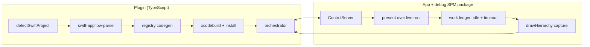
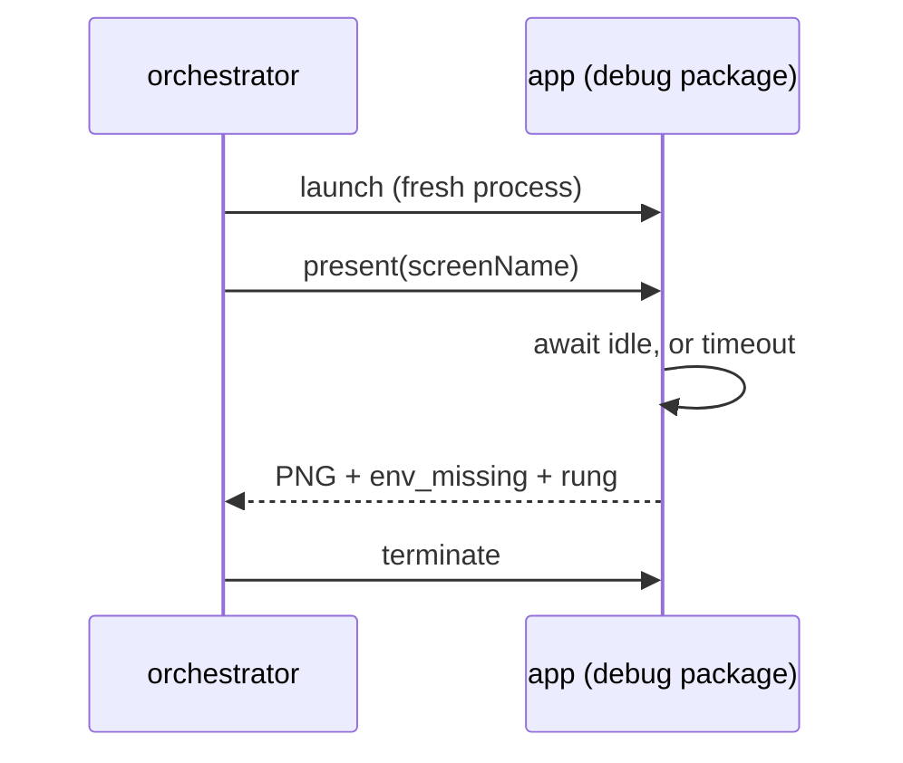

# SwiftUI app-flow — POC plan

Extends app-flow (today: React Native / Expo) to map the screens of **SwiftUI**
apps. Jetpack Compose is out of scope; UIKit is a later iteration.

## Agreed scope (unchanged)

| Dimension | Decision |
|---|---|
| Capture mode | **Fast only.** No deep-link mode, no exploration mode. |
| Instrumentation | Opt-in **debug SPM package**. No per-screen source changes. |
| App access | Xcode project in the workspace (source present, buildable). |
| Screen identity | Swift view type name (e.g. `ProfileView`). |
| Milestone | Structure + UI (screenshots). |
| Codegen | Acceptable. Working POC first, DevExp after. |
| Mocked data | Fine. `ProfileView()` or `ProfileView(user:)` — one, not both. |
| Unpresentable routes | Recorded as "what's missing" and left, as RN does. |
| Registry file | Gitignored. |
| UI states | Ignored for now. |
| Session-recording corpus | Deferred. |

**Guiding rule:** a value is only ever observed, never invented. A screen we
refuse to construct is a correct answer; a screen built from a fabricated value
renders a lie.

## Corrections to what was built

Three things drifted past the agreed boundary during the design iterations and
are being **removed**, not demoted to opt-in.

| Removed | Why it drifted | Replacement |
|---|---|---|
| `.captureReady(_:)` + `CaptureReadyKey` (`Harness.swift:31,42,555`, 13 call sites in `Screens.swift`) | The readiness brief priced *correctness* only, so the search walked into the app. `ready` was the only cheap 13/13. | **Work ledger (`idle`) + timeout backstop**, both inside the package. **13/13** correct once the reset changed too, zero source changes. |
| `CaptureResettable` / `CaptureStores` (`Domain.swift:45,52`; 4 store conformances) | Same family — requires app types to conform. Introduced to fix capture-to-capture state leak. | **Relaunch per screen.** Re-measured 594–614 ms over 8 runs. A fresh process cannot leak, and it gives crash isolation for free. |
| `Rung.synthesized` (`Model.swift:62`, `main.swift:322,335,343`) | A plain non-`Binding` parameter given a made-up value — a direct breach of observed-never-invented. | Plain param with no observed value → **`skipped`**, with the type recorded in `missing`. Costs **0 screens**: the rung resolved to 0 across all three corpus apps. |

`neutralSynthesis` **stays for `Binding` parameters only**. A `Binding` has no
observed value by nature; supplying one is structural, and the `bindingsOnly`
rung already covered it.

### Why `idle` is enough

Measured on iPhone 17 Pro / iOS 26.2, 13 screens, 3 runs, ground truth = 4 s-settled capture.

| Signal | Correct | Cost | Source changes |
|---|---|---|---|
| `frame` | 10/13 | 64–83 ms | none |
| `stable` (pixel quiet window) | 10/13 | 350–401 ms | none |
| **`idle` (work ledger)** | **13/13** | **250–2901 ms** | **none** |
| `timeout` (flat settle) | 13/13 | 4001 ms | none |
| ~~`ready`~~ | ~~13/13~~ | — | per-screen |

**Re-measured after the removals** (same device, same metric, `results/`
overwritten). `idle` went from 12/13 to 13/13, and the reason is worth keeping:
its one miss was `TwoStageOrderView`, and it was caused by the *in-process
reset that is also being removed*. `CaptureResettable` bumped each store's
epoch, and `TwoStageOrderStore` only calls `WorkTracker.begin` for its second
stage inside a completion guarded by that epoch — so the reset dropped the
continuation and the ledger never learned the items fetch was pending. `idle`
fired at 1050 ms, mid-fetch. With a relaunch as the reset, both stages are
tracked and `idle` fires at 1800 ms, after stage 3, on every run.

So the screen is still adversarial by construction — static for 1.25 s, then it
mutates — but a work ledger that *sees* the pending work is right about it. The
earlier 12/13 measured the harness, not the signal.

`stable` is structurally dead, not merely untuned — swept 4 raster sizes × 5
thresholds and it was never once right on an async screen. `CALayer.render(in:)`
draws the model layer tree, so a `repeatForever` animation diffs by exactly
0.00000.

## POC structure

Per screen, the orchestrator drives this loop:

Relaunching every screen is what makes reset and crash isolation free. Cost is
~620 ms/screen; for 13 screens the readiness path still totals ~8 s against 52 s
for a flat 4 s settle.

## In the POC

1. **Remove** the three drifted mechanisms above; re-run the verdict harness to
   confirm `idle` + timeout reproduces 12/13 and 13/13 with no source changes.
2. **Relaunch-per-screen** capture loop, replacing store reset and giving crash
   isolation (today one bad screen kills the app and ends the run).
3. **Parser invocation contract.** ✅ The contract is stated in full at the top
   of `native/swift-appflow-parse/Sources/swift-appflow-parse/main.swift` and
   consumed by `src/app-flow/swift-parse.ts`: source root in, one JSON object on
   stdout, human text on stderr, exit 0 / 2 (usage) / 3 (unreadable root), with
   `--version` and a `contractVersion` stamped on every report. A root holding no
   SwiftUI is a report, not a failure. `resolveSwiftParser` prefers an override,
   then `vendor/`, then a local `swift build -c release`; `npm run
   rebuild:swift-appflow-parse` is the explicit prepare step and stages the
   binary where a shipped one would go. Toolchain absence, build failure and
   contract skew are three different sentences. This is the *interface*,
   deliberately not the distribution story — see "Parser distribution" below.
4. **Parse → codegen handoff.** `screens.json` is currently hand-authored; wire
   the parser's real output into `generate-registry.py`.
5. **Registry into a real build** — `.xcodeproj` / SPM integration, `#if DEBUG`
   guarded, generated file gitignored.
6. **app-flow integration, Fast mode only.** Lift the `mode === 'swiftui'`
   refusals at `src/app-flow/index.ts:132`, `index.ts:195`,
   `src/app-flow/orchestrator.ts:901`.
7. **Telemetry** per AGENTS.md, reusing `src/ui/telemetry.ts` helpers; add the
   `app_flow.project_detect.duration` line to `docs/telemetry.md`.
8. **Hygiene** — unstage the 19 build artifacts and PNGs currently staged
   (`.app` binary, `.dSYM`, `shots/`); gitignore `build/` alongside `.build/`.

### POC exit criteria

Fast mode runs end-to-end against a real SwiftUI app in the workspace and
produces a screen graph with screenshots, where every screenshot is either
correct or explicitly refused — no screen constructed from an invented value,
and no captures taken before the screen settled.

Current parser coverage, which the POC inherits:

| App | Screens resolved | Route edges |
|---|---|---|
| IceCubesApp | 44/59 (75%) | 31/37 |
| isowords | 13/18 (72%) | 0/0 |
| sample-food-truck | 18/19 (95%) | 3/4 |

Re-measured after `Rung.synthesized` was removed: **unchanged**, as predicted.
What did change is `viewsConstructible`, which counts leaf components as well as
screens — 85→71, 45→44 and 65→62. Those 18 views were being constructed from an
invented `[]`, which is exactly the breach; none of them is a screen and no
route edge moved.

## Remaining after the POC

**Parser distribution**

The POC runs the parser through a fixed CLI contract (item 3), built locally
from source. The options, measured against the current binary — **17 MB**,
arm64-thin, ad-hoc linker-signed, linking only system dylibs (swift-syntax is
statically linked; a universal build would be ~34 MB):

| Option | What it is | First run | Version skew | Our cost |
|---|---|---|---|---|
| **A. Ship prebuilt** | binary in the npm package | instant | **none** | CI artifact per arch, package size |
| **B. Build on install** | `swift build` on the user's machine | **129 s cold** | **exposed** | nearly zero |
| **C. SourceKit** | drive `sourcekit-lsp` from Xcode | needs the project to **build first** | none | high — compile args / index store |
| **D. tree-sitter-swift** | reimplement in TypeScript | instant | none | **full Collector rewrite** |

**A and B are the same code**, so moving between them is a packaging change, not
a parser change — reversible and nearly free. C and D are different parsers.

Version skew is the real axis: B is the only option exposed to it. swift-syntax
majors track Swift releases, and the parser pins **604.0.0** against Swift 6.4,
so a user on an older Xcode may simply fail to build it. A removes that risk by
freezing parsing against our own swift-syntax.

C is tempting for the wrong reason. It would fix the liftability hole — the
syntax pass *assumes* the lift site imports the same modules, where SourceKit
would know — but it needs compiler arguments per file, which means building the
project before parsing it. Seconds become minutes. The useful form of C is a
**supplement**: the syntax pass finds candidates, SourceKit verifies only the
doubtful ones. Shipping A does not foreclose it.

D buys nothing here. We are macOS-only regardless (iOS dev implies Xcode), so
cross-platform is worthless, and we would lose swift-syntax's macro handling —
exactly where subtlety already bit us (`#Preview` parses as a *different node
type* at file scope than nested).

**Plan: B for the POC, ship A, keep C as a precision upgrade.**

Deferring is only safe because the JSON contract is the seam. Holding it stable
means a later swap replaces the producer without touching codegen, the
orchestrator, or the registry. **If that contract moves, this deferral stops
being free** — so the POC should freeze it early and treat changes to it as
deliberate.

**Soundness**

- "Upper-case-initial base is resolvable" assumes the lift site imports the same
  modules. Affects *all* lifted rungs.
- The conventional-name set (`mock`/`sample`/`preview`/`example`/`placeholder`)
  is a convention bet, not a guarantee.
- `callSite` can still contain synthesised arguments — e.g.
  `AccountDetailMediaGridView(account: .placeholder(), initialMediaStatuses: [])`
  reports `callSite` though `[]` is ours. Needs provenance threaded through the
  `preview` and `callSite` rungs.
- Startup self-test for the `String(describing: EnvironmentValues)` format —
  undocumented SPI, and the only mechanism that catches a missing environment
  key. No screenshot comparison ever can: `BrandedHeaderView` renders grey in
  both the capture *and* the ground truth.

**Found while freezing the contract (item 3)**

- `detectSwiftProject` returns only the conventional source root, so running the
  contract end-to-end against IceCubesApp parses `IceCubesApp/` (36 files,
  18/21 screens) and misses `Packages/`, where most of the app lives. The
  whole-repo parse the coverage table reports is 408 files and 44/59. Item 4 has
  to decide what a project's source roots are, not just how to call the parser.
- That narrower root also makes `routeEdgesConstructible` *over*-report: with no
  route enum in scope the associated-type list is empty, so every edge is
  vacuously constructible (37/37 against the whole repo's 31/37). An empty
  `enumCases` should not read as "nothing stands in the way".

**Pre-existing**

- `tests/telemetry.test.ts` does not run at all on `hur/add-app-flow` — the
  process crashes with `MCP error -32000: Connection closed`. The whole suite is
  dark.
- This worktree has no `node_modules`, so the five jsdom UI tests under
  `tests/app-flow-*.test.ts` fail on `mkdtemp`. The other 245 pass.

**Deferred by decision**

UI states · session-recording corpus · deep-link mode · exploration mode ·
Jetpack Compose · UIKit.
