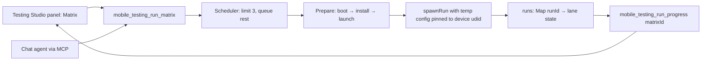

# Test matrix — plan

Status: **bundled mode implemented** (milestones 1, 2, 3 and 5). Project mode (milestone 4) works through a text-rewritten copy of the config (`runProjectLane`, `rewriteLaneConfig` in `testing-run.ts`); the upstream `e2e run --device` flag that replaces it is tracked in `items-todo.md`. Docs: [testing-panel.md](testing-panel.md#running-on-several-devices-test-matrix), [mcp-tools.md](mcp-tools.md).

Run one recorded e2e test on several devices at once — e.g. iPhone 17, iPhone 16 and a Pixel emulator — from the Testing Studio panel, or from chat through MCP.

## Goals

- Pick N devices (iOS simulators, Android emulators, connected phones) in the Testing Studio panel and run the open test on all of them in parallel.
- One lane of live progress and one result per device; a failure on one device does not stop the others.
- Devices that are off get booted; devices missing the app get it installed.
- At most **3** devices run at once by default; the user can change the limit. Extra devices queue.
- The same backend tool serves the panel and chat agents ("run this test on 3 devices").
- The project's own files are never modified: any config override lives in a throwaway temp file.

## Non-goals (v1)

- Sharding many test files across devices (the runner's device pool already does that; a matrix runs the *same* test on every device).
- Hosted device farms (`DeviceProvider`).
- Cross-device result diffing or screenshot comparison.

## Where things are today

| Concern | Today | File |
|---|---|---|
| Run trigger | `mobile_testing_run_test`, no `deviceId` sent | `packages/ui/src/testing-panel.ts:1208` |
| Run state | module-level `progress` + `running`, one run at a time | `packages/core/src/testing-tools.ts:55` |
| Run execution | `runRecordedTest` → `spawnRun`, one `e2e run` process | `packages/core/src/testing-run.ts:356,467` |
| Bundled config | one target, `mobile({ platform })`, `workers: 1`, no device | `packages/core/src/testing-run.ts:419` |
| Project config | temp wrapper importing the project's `e2e.config.ts` + progress reporter | `packages/core/src/testing-run.ts:174` (`progressConfigSource`) |
| Device selection | single device, `DeviceAppsStore.selectDevice` | `packages/ui/src/device-apps.ts:53` |
| Device lists | `mobile_list_simulators`, `mobile_list_ios_devices`, `mobile_list_android_devices` | `packages/ui/src/simulator-panel.ts:833` |
| Boot | `bootAndroidEmulator`; iOS boot via agent-device catalog | `packages/core/src/android-emulator.ts:19`, `agent-device-catalog.ts` |
| Install | `mobile_install_app` takes a built `.app`/`.apk` path | `packages/core/src/app-control/tools.ts:78` |

## Architecture



**Why one process per device, not one process with a device pool:** a pool hands *different files* to different devices. A matrix needs the *same* test on each device, independent progress, independent failure and independent cancel. One `spawnRun` per device gives all four with the existing code path.

## Backend changes (`packages/core`)

1. **Run registry** — replace `progress`/`running` globals in `testing-tools.ts` with:
   ```ts
   type LaneState = "queued" | "booting" | "installing" | "running" | "passed" | "failed" | "cancelled" | "error";
   interface Lane { runId: string; deviceId: string; deviceName: string; platform: "ios" | "android";
                    state: LaneState; progress: TestRunProgress[]; result?: TestRunResult; error?: string; }
   interface MatrixRun { matrixId: string; testPath: string; lanes: Lane[]; startedAt: number; limit: number; }
   ```
   A single-device run becomes a matrix of one, so there is one code path.

2. **Tools**
   - `mobile_testing_run_matrix { testPath, devices: {deviceId, platform}[], limit? }` → returns `{ matrixId }` immediately; work continues in the background.
   - `mobile_testing_run_progress { matrixId }` → `{ lanes }`. Existing no-arg call keeps working by returning the latest run.
   - `mobile_testing_cancel { matrixId, deviceId? }` → kills one lane or all.
   - `mobile_testing_run_test` stays as a thin wrapper (matrix of one) for compatibility.

3. **Scheduler** — a small promise pool with `limit` (default 3, from settings). Lanes start in selection order; a finished lane frees a slot.

4. **Prepare step per lane** (before `spawnRun`)
   - **Boot** if not booted: Android via `bootAndroidEmulator`; iOS via the existing agent-device/simctl boot path. Wait for boot-complete.
   - **Install** if the app is missing (see *Install source* below).
   - Reuse the existing pre-run `mobile_launch_app` behaviour per device.

5. **Per-lane config, pinned to one device** — all in a per-lane temp dir, deleted after the run:
   - *Bundled mode*: `bundledConfigSource` gains `device: <udid>` → `mobile({ platform, device })`, and the target name becomes unique per lane.
   - *Project mode*: `progressConfigSource` gains a `device` override that rewrites each mobile target for the lane's platform to that device (see *Risks* — needs an upstream hook).
   - Each lane passes its own `--output <tmp>/<runId>` so reports and artifacts don't collide.

6. **Device leases** — `TestingDevices.release()` today frees the one recorder device. A matrix run releases the recorder/mirror only on devices in the matrix, and the panel marks those devices "busy" until their lane ends.

7. **Per-platform app id** — the matrix request carries `{ ios?: bundleId, android?: packageName }`; a project may use different ids per platform. Lanes for a platform without an id fail fast with a clear message.

## UI changes (`packages/ui`)

1. **Matrix section in the setup popover** (`components/testing-setup.tsx`)
   - Checklist grouped iOS / Android, from the same lists as the Platforms panel, with booted/off and "app not installed" badges.
   - "Run up to [3] at once" number field.
   - Selection and limit saved per project.

2. **Run button** — shows "Run on N devices" when N > 1; plain "Run" otherwise.

3. **Lanes view** (`components/testing-view.tsx`)
   - One row per device: name, OS, state (Queued / Booting / Installing / Running step k of n / Passed / Failed), duration, cancel.
   - Clicking a lane opens today's step-by-step source view for that lane's `progress`/`result`.
   - Summary chip: "2 passed · 1 failed".

4. **State** (`testing-panel.ts`) — `running: boolean` + single result become `matrix?: MatrixRun`; the 400 ms poll calls `run_progress { matrixId }` and stops when every lane is terminal.

## Chat / MCP

`mobile_testing_run_matrix` is a normal MCP tool, so a Codex/Claude chat can say "run checkout.e2e.ts on iPhone 17, iPhone 16 and the Pixel" → list devices → call the tool → poll progress. Tool descriptions should state the default limit and that devices will be booted and the app installed.

## Settings

| Key | Default | Notes |
|---|---|---|
| `testing.matrix.maxParallel` | 3 | 1–8 |
| `testing.matrix.devices` | `[]` | per project, list of device ids |

## Risks and open decisions

1. **Overriding the device in a project config.** `mobile({...})` returns an opaque `EngineHandle`; its options can't be read or changed after the fact. Options:
   - **a. Upstream hook (preferred):** add a device override to the e2e runner — e.g. `e2e run --device <id>` or an `E2E_DEVICE` env var the mobile engine honours. Clean, works for every project config.
   - b. Rebuild the engine in the wrapper as `mobile({ platform, device })` — loses any other `mobile()` options the project set.
   - c. Bundled-mode-only matrix in v1; project mode later.
2. **Install source.** `mobile_install_app` needs a built `.app`/`.apk`. Proposed order: (1) copy from a device in the matrix that has it — iOS `simctl get_app_container <udid> <id> app`, Android `adb shell pm path` + pull (split APKs need `install-multiple`); (2) project build output if known; (3) otherwise mark the lane "App not installed" with a hint to build.
   - iOS simulator builds can't go onto physical iPhones; physical devices without the app fail that lane.
3. **Model cost and rate limits.** Tests using `agent.act/assert/waitFor/extract` call the model per step per device; N devices ≈ N× calls. The default limit of 3 bounds this; show a note in the popover when the test needs a model.
4. **Machine load.** Each booted simulator/emulator is heavy; the limit also bounds this. Booting counts against the limit.
5. **Android ports.** Multiple emulators need distinct console/adb ports; `bootAndroidEmulator` must pick a free port per AVD. Verify.
6. **Same-device conflict.** The recorder, mirror and a matrix lane can't share a device ("one session per device"). Disable recording on matrix devices while their lane runs.

## Milestones

1. **Backend registry + bundled-mode matrix**: run registry, `run_matrix`/`run_progress`/`cancel`, scheduler, device-pinned bundled config, per-lane output dir. Tests for scheduler and config generation.
2. **Prepare step**: boot + install + launch per lane, with lane states.
3. **UI**: device checklist, limit, lanes view, per-lane detail.
4. **Project mode**: device override in the project config, via decision 1.
5. **Docs**: update `docs/testing-panel.md` and `docs/mcp-tools.md`.

## Done when

- From the panel, selecting iPhone 17, iPhone 16 and a Pixel emulator and pressing Run produces three lanes that run concurrently, each ending in its own pass/fail with step detail.
- With 4 devices selected and the default limit, the 4th lane queues until a slot frees.
- An off simulator is booted and a device without the app gets it installed before its lane runs.
- The same works from a chat agent through `mobile_testing_run_matrix`.
- No file in the user's project is created or changed by a matrix run.
