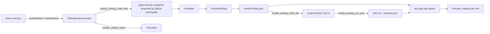
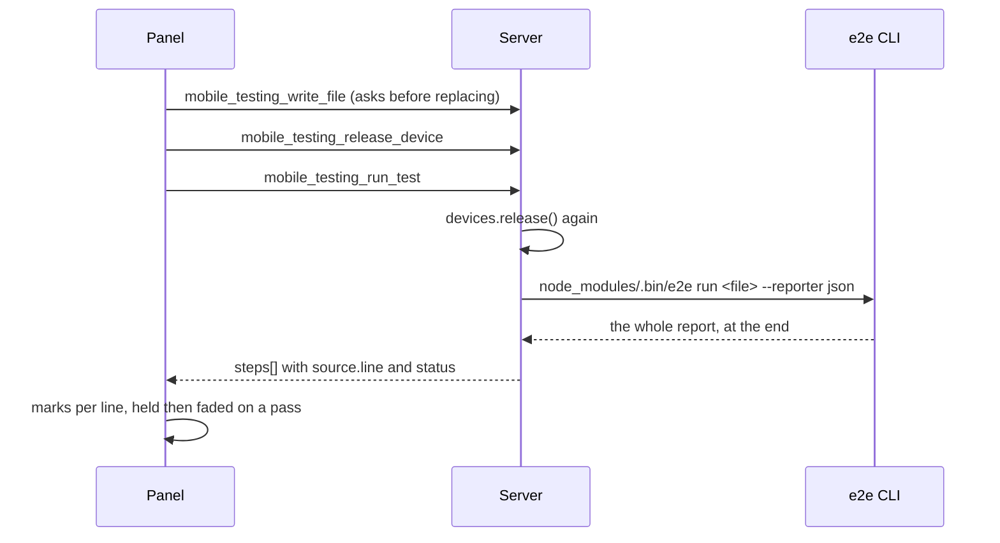
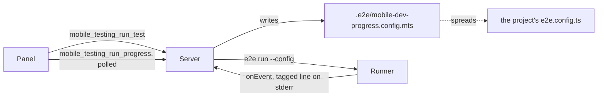

# Testing panel — record e2e tests from the mirror

Status: steps 1-6 of the build order are implemented — the tab, the project picker, launching the
app, recording through the mirror's element menu with selector resolution and a live preview,
saving the test into the project, and running it with per-line marks. Typing and swipes are
recorded from the menu rather than from the gesture, which is step 5's own answer; a drag on the
mirror still records nothing (step 7), and the Maestro emitter (step 8) is still design only.
A test can also be recorded by the user's own coding agent, which drives the same recorder from
the server — see [docs/agent-recording.md](agent-recording.md).

A new workspace tool, **Testing**, that turns the existing simulator mirror into a
Maestro-Studio-style recorder: pick a project, launch its app, tap the mirror, and watch the test
source grow one step per interaction. The file is written to the project when the user clicks Save.

First pass targets the **iOS simulator** and the **e2e** runner (`@e2e-dev/mobile`).
Maestro YAML is a second emitter behind the same recorder.

## Scope of the first pass

| Decision | Choice |
|---|---|
| Platform | iOS simulator only (Baguette stream path) |
| Tap → code | Resolve a selector from the accessibility tree; fall back to coordinates |
| Output | Live **preview** in the panel; written to the project's `tests/<name>.e2e.ts` only on **Save** |
| Emitter | e2e TypeScript now; Maestro YAML later, same recorder |

Android (`serve-emu`) and physical iOS (`ios-mirror`) are explicitly out of the first pass.
Both already have input and hierarchy paths, so they slot in behind the same interfaces.

## What already exists

Almost every primitive is in place; the panel is mostly wiring.

| Need | Existing piece |
|---|---|
| Mirror frames | `packages/core/src/stream-sessions.ts:78` → MCP `resources/read`, drawn on canvas in `packages/ui/src/simulator-panel.ts` |
| Pointer capture over the mirror | canvas `pointerdown/move/up` at `packages/ui/src/simulator-panel.ts:855-892` |
| Touch injection | `mobile_stream_input` (`packages/core/src/panel-tools.ts:343-390`) → `stream-input.ts` batching |
| Accessibility tree | `baguette.describeUi(udid)` (`packages/core/src/baguette.ts:118`), exposed as `mobile_describe_ui` (`panel-tools.ts:292`) |
| Hit-testing a point | `componentAt` / `componentsAt` (`packages/shared/src/screen-annotations.ts:89,120`), already driving hover/select in the mirror |
| Tab registration | `toolNames` in `packages/ui/src/workspace-tools.ts:11`, label/icon map in `packages/mcp-app/src/components/workspace.tsx:27` |
| Maestro replay (later) | agent-device script-replay runs compatible Maestro YAML (`packages/runtimes/agent-device/tools.json`) |

Two things do **not** exist:

1. **No path writes into the user's project.** Every `writeFile` in the server targets its own
   state (recordings, tracesift, clipboard temp files). The server does not know a project root.
2. **No codegen of any kind.**

## Unsaved recordings

A flow lives in the recorder, which lives in the panel document, and the host rebuilds that
document whenever the user looks at another tool or another chat. Until Save writes a file there
was nothing else holding it, so a recording the user had not saved — or one their agent made while
they were reading its answer in the chat — was simply gone when they came back. Both are the
ordinary way the panel is used, which made it the ordinary way work was lost.

So the panel keeps what it is holding, and lists what it has kept.

| Decision | Choice | Why |
|---|---|---|
| Where | `~/Library/Application Support/mobile-dev/testing/drafts/<id>.json`, beside `projects.json` | The plugin's own state. Nothing reaches the user's repository until they press Save, which is the whole promise of the Save button |
| What | The `RecordedStep[]`, not the emitted source | A flow comes back **editable**. The generated file is an output and nothing reads it back |
| When | Autosaved 700 ms after the last change, and once more as the panel is torn down | One write per edit burst, and the teardown flush covers the switch that used to lose the flow |
| Who | The panel for its own recording; the server for an agent's, at `agent_finish`/`agent_abort` | The panel may never have been looking. The server publishes the draft's id in `agent_state`, and the panel adopts it rather than keeping a second copy |
| Scope | Listed per project | A flow names elements of one app; another project's selectors have never existed in it |
| Until when | Deleted when the flow is written into the project, or when the user deletes it | The draft stood in for a file that now exists |
| How many | 30, oldest dropped | A safety net, not an archive |

A draft belongs to a **flow**, not to the panel. The recorder mints a `flowId` whenever the step
list stops being the same recording — Record on a flow the user did not choose to resume, Clear, a
kept recording reopened, an agent session beginning — and the panel keeps the draft pinned to that
id. `revision` cannot stand in for it: it moves for an edit and for a brand new flow alike, and
when the panel went by revision alone, recording a second test wrote it straight over the first
one's file. Two recordings, one row in the list.

The control is a popover beside the project picker, shown only once there is something in it, and
it holds **two groups**:

| Group | Holds | Starts |
|---|---|---|
| **Not stored** | The drafts: a kept flow with its step count, how long ago it was touched and whether the user or an agent recorded it. **New recording** is at its foot | Expanded — it is what is being worked on |
| **In the project** | The `.e2e.ts` files in the project's own `tests/` folder, newest first | Collapsed — it is the archive |

The second group exists because deleting the draft on save had an effect nobody asked for: the
test the user had just saved **left the list**. There was nowhere for it to go. Now it moves from
the top group into the bottom one, which is also the honest description of what Save did. The
bottom group is **read from the folder** rather than remembered, so a test written by hand, by an
agent or in another checkout is listed beside the recorded ones, and a test deleted outside the
panel stops being listed.

Opening a draft keeps the flow on screen first, so swapping between two loses neither, and it does
**not** start recording — the user opened a flow to look at it, and a stray tap on the mirror must
not append to it. A stored test is a readout: its name, its path under the project, and when it was
last written.

Both deletes **ask first**, in a popover hanging off the trash icon. A draft's steps cannot be
replayed from anywhere else, and a stored test is a file in the user's repository that nothing here
can put back — and both icons sit beside the row the user was reaching for. The question hangs off
the icon rather than replacing the row so the row it is about stays readable underneath it, and so
the question has room to name what will go and say that it cannot be undone, which a row the width
of a file name does not.

Six app-only tools carry it: `mobile_testing_drafts`, `mobile_testing_draft_read`,
`mobile_testing_draft_save` and `mobile_testing_draft_delete` over `TestDraftStore`
(`packages/core/src/testing-drafts.ts`), and `mobile_testing_tests` and
`mobile_testing_delete_file` over the project's own `tests/` folder
(`listTestFiles`/`deleteTestFile` in `packages/core/src/testing-projects.ts`) — the delete
annotated destructive, so the host asks as well as the panel. All six are in
`packages/core/src/testing-tools.ts`. The step schema they validate against is
`packages/shared/src/test-drafts.ts`, which is the one place a `RecordedStep` is described as data
rather than as a type. A stored test's path goes through the same `resolveTestPath` boundary the
write does, so a delete cannot climb out of `tests/`.

## Architecture



### Where the mirror sits

In the Testing panel the mirror is on the **left** and the preview and step list on the right;
every other tool keeps the simulator on the right. Recording is done by tapping the mirror and read
back in the preview beside it, so the mirror leads in the same direction the panel is read. It is
one flag in `packages/mcp-app/src/components/workspace.tsx` that reverses the resizable group's
children, and only when the workspace is side by side — stacked, "left" is the top panel, which the
simulator already is. The hover outline is unaffected: `TestRecorderOverlay` positions it from the
annotation store's viewport, which is measured **inside the stage**, so moving the stage within the
workspace does not move the rectangle, and the stage's own `ResizeObserver` re-measures when the
swap changes its width.

#### The mirror has to be there when the panel opens

The panel is useless without a device: with no mirror it shows "Boot a simulator to record against
it." while the user is looking at a booted simulator. That is what it did, and the cause was not in
this panel at all. The workspace's automatic layout was decided **once**, from the first device
list — and the opening tool *starts* the backend, so that first list routinely comes back before
anything has been found. It resolved to `none`, both device panels stayed hidden, the platform
selector read "Platforms", and nothing ever asked again; discovery found the simulator a moment
later and the panels selected it, but the layout was already settled. Picking the platform by hand
was the only way to see a device that had been there all along.

`WorkspaceDevices.settleLayout` (`packages/ui/src/workspace-devices.ts`) is the second look: a
panel's selection changing — which is what discovery does — finishes a layout that is still
unresolved. It only ever turns `none` into a platform. A layout that resolved to something, and
any layout the user chose themselves, are left exactly as they are.

#### The three panes

| Pane | Default | Why |
|---|---|---|
| Mirror | 25% of the workspace | It is tapped, not read. A phone at a quarter of a wide workspace is still a usable target |
| Preview | 45% | A generated test file is the thing being read, and a wrapped line of `screen.getByRole(…)` is unreadable |
| Steps | 30% | A list of short labels, which is what is left |

All three are **draggable**: the mirror against the tools through the workspace's own handle, and
the preview against the steps through a handle of their own
(`testing-preview-resizable`/`testing-steps-resizable` in
`packages/ui/src/components/testing-view.tsx`). The split that suits a flow changes while the flow
is being written — a long file to read, a long list to reorder — so the numbers above are defaults
rather than a layout. The preview and the steps are 60/40 **of the tools pane**, which is what
makes them 45% and 30% beside a mirror with 25%; the panel's own padding and the gaps between the
panes come off the two that are read, so measured against the whole window they land a couple of
points under that.

**The row is asked for by this panel, not inherited from `split`.** `split` is `wide && fullscreen`
— true only in the fullscreen workspace — and everywhere else the workspace group was vertical:
the mirror kept the 60% default meant for a tool stacked underneath it, and the preview and the
steps were left sharing the 40% of height below, which at a narrow tools pane stacked them too.
That is how the three panes came out at roughly 60/22/16 instead of 25/45/30. `testingSplit` in
`packages/mcp-app/src/components/workspace.tsx` now asks for a horizontal workspace wherever the
window is wide enough for one, and the panel's own group has no stacked form at all. Under that
width the workspace stacks as it always did, with the mirror on top. `tooling/hosts/hosts.spec.ts`
holds the three shares against both the fullscreen workspace and the panel beside the chat.

### 1. The tab

- Add `"testing"` to `toolNames` (`packages/ui/src/workspace-tools.ts`).
- `TestingPanel` controller in `packages/ui/src/testing-panel.ts`, same `subscribe`/`getSnapshot`
  store pattern as `LogsPanel`.
- `packages/ui/src/components/testing-view.tsx` renders the step list, the project picker, the
  record/stop control and the generated source.
- Entry in the label/icon map in `workspace.tsx`.

The view sits where the other tool views sit — beside the mirror, which `DeviceWorkspace`
already renders. No new mirror.

### 2. Project selection and launch

The panel has no notion of a project today. Add:

- **The user always picks the project explicitly** — the panel never infers it from the server's
  cwd. A folder picker; the choice is persisted so it is one click on the next session. Validate it by
  reading `e2e.config.ts` (or `package.json` depending on `e2e`). Persist the last choice in
  panel state.
- Read the chosen `e2e.config.ts` to learn the **target** and the **bundle id**, so the recorder
  launches the same app the generated test will (`app: { bundleId: … }`). Parsing TypeScript config
  is the awkward part — prefer shelling out to the project's own `npx e2e config --json` if the CLI
  exposes it; otherwise fall back to asking the user for the bundle id once and caching it.
- Launch via the existing device/app tooling (`DeviceAppsStore`), not a new path.

### 3. Recording a tap

The ordering matters, and it is the one genuinely tricky part:

1. `pointerdown` on the canvas. **Before** forwarding input, the recorder needs the hierarchy of
   the screen as it is *now* — after the tap it may be gone.
2. Keep a **cached tree**, refreshed on screen-settle (the mirror already knows when frames stop
   changing) and invalidated on every injected input. On `pointerdown`, hit-test against the cache;
   if the cache is stale, issue `mobile_describe_ui` and hold the input for one round trip (tens of
   ms on loopback — acceptable; a dropped tap is not).
3. Forward the touch to the device exactly as today, so the app behaves normally while recording.
4. `componentAt(point)` gives a `ScreenComponent { role, identifier, label, value, bounds, react }`.

While recording, `pointermove` runs the same resolution against the same cached tree and draws an
outline over the mirror with the step it would record (`packages/ui/src/components/test-recorder-overlay.tsx`).
It is a preview, not a second code path: what is outlined is what a tap records. The outline is
cleared whenever the cache is invalidated, because the screen it described is gone.

**Record shows a `preparing...` overlay until selection actually works.** Pressing Record arms the
recorder at once, but nothing on the mirror can be *named* until the runner's element tree has been
read — attaching to the app and projecting the tree takes a second or two — so the panel used to
say "Stop" while the first few seconds of pointing did nothing, with nothing on screen to say why.
That reads as a broken recorder rather than as a wait. `start` now warms the tree itself and holds
`preparing` until that read lands, and the overlay covers the **canvas** (not the whole stage), so
it says where the wait is. It lets clicks through: the mirror still drives the app while the tree
is being read. A read that fails drops the flag rather than leaving the overlay up — the overlay
must never outlive the thing it is explaining — and the first hover retries as it always did. The
wait has its own timing, `ui.testing.record_prepare`, because "how long is Record unusable for" is
a different question from `ui.testing.tree_read`, which also covers the warm reads during a
recording.

**Pointing at a step tints the lines it emits**, and the tint goes with the pointer. What made
*leaving* a step light its lines up again — and then fade them out over more than a second — was
not the clearing at all: the highlight used to be a `background` plus `animation: none`, and the
lines a step added keep `is-new` for as long as the file does not change. Suppressing the arrival
animation while a line was highlighted **cancelled** it, and letting it back on mouse-leave
**restarted it from the beginning**. The highlight is painted as a `::before` layer now, so the
two never touch the same property and there is nothing to restart. The row clears the highlight
when the pointer leaves it, guarded so that a row already left cannot take it from the row the
pointer is on: the browser dispatches the leave of one and the enter of the next together, and the
order is not the one the eye follows.

### 4. Selector resolution

Priority, first match wins:

| Rank | Source | Emitted |
|---|---|---|
| 1 | `testId` | `screen.getByTestId("Submit")` |
| 2 | `role` + accessible name | `screen.getByRole("tab", "Explore")` |
| 3 | `placeholder` | `screen.getByPlaceholder("Search transactions")` |
| 4 | name or text | `screen.getByText("Explore Cities")` |
| 5 | accessible name | `screen.getByLabel("Forward, File-based routing")` |
| 6 | nothing resolves | `screen.tapAt(x, y)`, preceded by a wait, + a `// TODO: add a testID` comment |

These are the runner's own query kinds, counted the way `locate.js` counts them, over the runner's
own tree — see "Reading the runner's tree" below. In particular:

- **A role query needs a name.** `getByRole(role)` alone matches every element of that role, so a
  role with no accessible name is not a candidate at all. A search field whose only text is its
  placeholder has no name, which is why rank 3 exists: iOS accessibility offered the placeholder
  *as* the name, the recorder emitted `getByRole("textbox", "Search transactions")`, and it
  matched nothing.
- **The role is never translated.** It is whatever the engine's projection said, passed through.
  The one thing the recorder knows about roles of its own is which ones `getByRole` *accepts* —
  `e2e`'s `Role` union is closed, and the engine deliberately keeps an element type it has no role
  for as the type itself (`other`, `application`). Those fall through to ranks 4 and 5 rather than
  reaching the file as `getByRole("other", …)`, which would not compile.
- **`getByText` and `getByLabel` answer with the innermost match only.** A device tree echoes text
  upwards — iOS reports a React Native `Text` host view and the `StaticText` inside it with the
  same label — so counting both would flag as ambiguous nearly every piece of text on screen,
  while the runner resolves it uniquely.
- **A role query skips a hidden node**, as the runner does, so an off-screen twin is not a second
  match.
- Text is compared with whitespace collapsed, because the runner normalizes and an accessibility
  label carries the rendered line breaks.

`screen.tapAt` is the only step with nothing to wait on: every locator action waits up to the
action timeout for its element, but a coordinate is always "ready", so a recorded coordinate tap
fires into the splash screen and misses. A point step therefore carries an **anchor** — the
nearest element on the same screen that resolves uniquely — and the emitter puts
`await expect(<anchor>).toBeVisible()` in front of the tap as the gate the tap cannot express.

An **assertion** that resolves to a point is refused outright rather than recorded: there is
nothing for `toBeVisible` to name, so the step would emit only comments.

The ranks are tried over the **hit ladder** — every element the point sits inside, ordered by area,
innermost first — not over one element. The innermost element often carries nothing addressable
while something just outside it holds the name or the testID, and the wheel walks the outline out
and back in when the element under the pointer is not the one the test should name.

An icon-only control with no name of its own takes the **one** piece of text inside it; two and it
stays unnamed and the ladder moves outwards, rather than guessing.

**The simulator's chrome is not in the tree.** The clock, the Dynamic Island and the battery used
to arrive in the same tree as the app's own elements, and were chosen as steps and as waits — a
recorded flow once opened with
`await expect(screen.getByLabel("Dynamic Island, Empty")).toBeVisible()`. The runner's snapshot is
rooted at the application, so there is nothing to filter: `treeHealth` is down to `ok` and
`no-accessibility`, and the recorder refuses a step only when the tree is empty.

**Depth beats rank**: the innermost element that can be named at all wins, and the ranks above
only order the candidates *within* one element. An enclosing element is reached by pointing at it
or by walking out, never by quietly outranking what is under the pointer.

**Walking out.** The outline is at a level on the ladder, and the wheel over the mirror moves it:
out to the enclosing element, back in again, re-resolved from the cached tree at no cost. The label
reads `3/7`. Pointing at a different element starts again from the innermost. The recorded step is
whatever the outline shows, so what you see is what is written.

**Roles are passed through, never translated.** The engine's projection already mapped the
platform's element type onto the runner's role vocabulary, and it is the only thing that gets a
say: a second mapping here is what put `getByRole("link", …)` and `getByRole("rcttext", …)` into
saved files. The recorder's only knowledge of roles is which ones `getByRole` accepts; see
"Selector resolution" above.

Uniqueness check: run the candidate selector back over the same tree. If it matches more than one
node, fall to the next rank, and if all ranks are ambiguous, emit the best one with an index and
flag the step in the UI. The step list should show the chosen selector and let the user override it
from the other candidates — that override is what makes recorded tests maintainable.

iOS bounds are device points, matching the mirror's own coordinate space after the canvas scale
factor is applied; no normalization needed on this path. (Android bounds are screen pixels —
handle at the adapter, not in the emitter.)

### 5. Gestures beyond tap

Typing, long press and scroll-to are recorded, but **not by watching the gesture** — by asking for
them on the element, through the menu in the next section. A recorder that infers a `fill` from a
run of keystrokes has to guess where the run ends and which field had focus; a row that says
`screen.getByPlaceholder("Search transactions").fill("Paris")` guesses nothing. Secrets never reach
the file either, because the user types the value into the menu, not into the app.

Still missing:

- **Swipe**: a drag on the mirror records nothing. `pointerdown`→`move`→`up` over a threshold would
  become `screen.swipe({ direction })`, or `locator.swipe(...)` when the start point resolves.
- **Typed-as-you-go**: key messages flow through `stream-input` and are not recorded at all, so a
  flow where the user types into the app has to add the `fill` from the menu afterwards.

### 6. The element menu: assertions and everything else

A recorder that only taps produces worthless tests. The panel used to carry a global **Assert**
toggle, which armed the next tap to assert instead of acting. That is gone, and so are its tests:
one mode flag could express one extra step, and the moment typing, long-pressing and scrolling were
worth recording it would have needed one flag each.

**A left click only drives the app.** It records nothing, recording or not. Tapping to find the
next screen used to add a step for every tap on the way, which the user then deleted, and it made
"drive the app" and "record a step" the same gesture. Steps come from the menu alone.

**A row records the step and takes it.** A step recorded but never taken leaves the app on the
screen before it, so the next row would be resolved against a screen the test will not reach. `tap`
taps the element's own centre — where the runner's locator action lands, not the pixel that was
right-clicked — and `fill` taps the field and types. One gap: the runner's `fill` *replaces* a
field's contents and the mirror can only append, with no input message that clears a field, so a
`fill` into a field that already has text leaves the screen showing something the test will not
produce. The step is right; the screen behind it is not. `toBeVisible` and `scrollUntilVisible` do
nothing, because they change nothing: an assertion reads, and `scrollUntilVisible` is only offered
for an element the user just pointed at, which is on screen already.

In its place is Maestro Studio's model. **Right-click an element on the mirror and the panel offers
what the runner can do with it**. The selected element is named once, followed by compact actions:

```
Selected element
"Go To Explore List"

Tap
Check visibility
Scroll into view
──────────────
All commands     ›
```

**One row per kind of thing to do, not one per variant.** An earlier pass listed `longPress` beside
`tap` and `toHaveText` beside `toBeVisible`, which made the menu five near-duplicates of one
selector — harder to read than the three choices it was actually offering. The rest of what the
runner can express hangs off **All commands** as a submenu of its own, grouped into actions and
assertions, so `longPress`, `doubleTap`, `not.toBeVisible`, `toContainText`, `toHaveValue`,
`toBeEnabled`, `toBeDisabled` and `toBeSelected` no longer need the user to leave the panel and
write the line by hand. Only the short list is in front of them by default.

**The submenu is a panel of its own and opens on hover.** Pointing at the row is enough — a click
and keyboard focus open it too — and it is drawn beside the menu rather than replacing what was in
it, so the selected element and the short list stay visible behind it. It always opens to the
right, the side its chevron points at. There is no flip to the left: this panel is often only a
few hundred points wide, so "flip when it does not fit" meant it opened on the left nearly always
— a chevron pointing one way and a panel opening the other. When the right has no room it is
pushed in from the window's edge instead, overlapping the menu it came from, as a cascading menu
does in a tight window; it is also narrower than that menu, so part of it stays visible behind.
The row and the panel are one hover target with a gap between them, so leaving either only starts
a close that entering the other cancels.

A **step row's** own "Change command" is the same branch with `side: "left"`, which asks for the
left outright rather than only when the right has run out. It used to replace the step menu with
the command list and a Back row — navigation, not a menu: the step the user was acting on went
away, and the only way back was a button put there for the purpose. As a branch the step stays on
screen beside the commands. It opens on the left because the step list is the **rightmost** pane in
the workspace: to its right is the window's edge, and to its left is the preview, which is where
there is room. It still falls back to the right when the left cannot hold it, because a panel off
the edge of the window shows nothing at all.

**Both popovers are portals fitted to the window, not to the stage.** The stage is a box with the
device in it and it clips what it contains, so a menu placed inside it was cut off at the bottom of
a short panel — and the old placement guessed the menu's height rather than measuring it. They are
rendered into `document.body`, positioned `fixed`, and measured through a `ResizeObserver` so a row
that opens a form re-fits the menu: below the element when the window has room, above it when it
does not, pinned to the edge they ran past when neither side fits, and scrolling only once they
are taller than the window itself. The arithmetic lives in `packages/ui/src/popover-placement.ts`,
apart from the component, so it can be checked against real layouts — a short panel, a narrow one
— rather than only through a DOM with no layout in it. They are free to lie over the mirror, the toolbar or the panel's edge — what
they must never be is clipped. Each is hidden until it has been measured, so neither is seen at the
position it was measured from, and because the anchor is read at measure time rather than passed as
numbers, a panel resized or scrolled under an open menu takes the menu with it. The canvas still
dismisses the menu when it is clicked through; a pointer down anywhere outside both popovers does
too, since neither is inside the canvas any more.

The exact TypeScript remains on each row as a hover tooltip and appears in the live test preview
after selection. It is still produced by the same `stepExpression` used by the emitter, without
making the user scan the same selector once per action. Choosing an assertion row records the step
without touching the device; action rows such as tap and fill also perform the action so recording
can continue from the resulting screen.

What is offered comes from the element's role and what it carries, never from the app:

| Row | Offered when |
| --- | --- |
| `.tap()` | any element a selector names |
| `.fill("…")` | the role is `textbox`, `searchbox`, `combobox` or `spinbutton`, or the element has a placeholder — which only a text field does |
| `expect(…).toBeVisible()` | any element a selector names |
| `screen.scrollUntilVisible(…)` | any element a selector names |

Under **All commands**, the same gating holds: `.fill("…")` and `toHaveValue` need a text field,
`toHaveText`/`toContainText` need an element with text of its own to start from, and everything
else is offered for any element a selector names.

A row that needs a value asks for one in the menu rather than emitting an empty string literal:
`fill` starts from the field's current value, the text matchers from the element's own text.

Only actions the runner can really perform on a device are offered. `secondaryTap`,
`selectOption`, `setInputFiles`, `scrollIntoView` and tap `modifiers` all exist in the runner's
typings and all fail on a device with `UNSUPPORTED_CAPABILITY`, so they are not rows.
`check()`/`uncheck()` and `toBeChecked` are left out for the same reason by a different route:
the runner has them, and whether a device reports a `checked` state at all depends on the platform
and the component — an Android `Switch` does not — so a row for them would emit a step that cannot
be relied on to run, which is worse than a missing row. `doubleTap` is offered and is the one
command the panel cannot perform exactly as written: the input path has a single tap in it, so the
gesture is sent as two taps to keep the screen in step with the flow.

One thing the menu needed fixing for: the recorder re-attaches its reader whenever the simulator
panel refreshes its device list, which is every few seconds, and `attach` used to invalidate the
cached tree every time. Through `clearHover` that took the outline — and any open menu — away about
a second after it appeared, which is exactly long enough to look like a flicker rather than a bug.
Only a reader that has actually changed invalidates now.

The menu is anchored to the **element**, not to the pointer, so the wheel-driven parent walk still
applies: walk the outline out to the enclosing element and the menu re-asks what can be done with
the element it walked to, rectangle and rows together.

It carries that rectangle itself rather than borrowing the hover outline's. The outline is dropped
by anything that invalidates the tree — an input, a frame, a read that is slow or fails, all of
which are ordinary while recording — and a menu the user asked for explicitly must not be taken
away with one. The menu's concurrency is its own too (`menuToken`): only another right-click or a
dismissal cancels it, never a hover that happens to land during its read.
A coordinate is offered the tap and nothing else. There is nothing about a point to be visible, to
hold text or to scroll to, which is the refusal the recorder already made for a point assertion.
The menu says so in a line above the row: three rows missing with no explanation reads as a broken
menu rather than as an answer.

#### When nothing names the element uniquely

The ranking prefers a unique candidate over an ambiguous one — depth first, rank within a depth,
and the first candidate that resolves to exactly one element wins whatever its rank, for the element
under the pointer or for one enclosing it. So reaching the ambiguous case means *every* candidate
was ambiguous, which happens for real:

| element | role | unique selector |
| --- | --- | --- |
| the Settings **tab** | `tab` | `getByRole("tab", "Settings")` — matches 1 |
| the Settings **heading** | `text` | none |

`getByRole` does not accept `text`, so the heading has only its own text to go on, and the tab
carries the same text. Nothing narrows it either: `filter({ hasText })` is a substring of the same
text, `filter({ has })` has no distinguishing child to point at, and there is no ancestor to scope
under — on this app every content node's parent is the application root.

**So the step is narrowed by position.** `screen.getByText("Settings").nth(0)` runs on the device;
the bare selector fails with `LOCATOR_AMBIGUOUS: locator matched 2 nodes`. The index is the
position of the element the user actually pointed at among that selector's matches — the recorder
resolved that node, so it is recorded rather than guessed, and pointing at the *second* match
records `.nth(1)`. The match order is the snapshot's own: the projection flattens the tree depth
first and the panel passes it through untouched, so the panel's index and the runner's index are
the same index.

The honesty stays where it belongs. A position is more brittle than a name, so:

- the emitted line carries a note — not a TODO — saying how many elements match and that a testID
  would pin it by name. Nothing has to be edited for the test to work;
- the step list reads `Expect visible "Settings" (1 of 2)` and still flags it `ambiguous`, and the
  menu says how many match and that the step is pinned by position;
- the selector is still `ambiguous` as far as the panel is concerned, because it is.

The alternative was a step that fails and a note asking the user to go and edit it. A recorded test
that runs, with the user told exactly what is weak about it, is the better of the two.

### 7. Emitting and writing

`RecordedStep[]` is the single source of truth. Emitters are pure functions over it:

```ts
interface StepEmitter {
  readonly id: "e2e" | "maestro";
  emit(steps: RecordedStep[], meta: { title: string }): string;
}
```

The e2e emitter produces exactly the shape of a hand-written deterministic test:

```ts
import { test } from "@e2e-dev/mobile";
import { expect } from "e2e";

test("<title>", async ({ app, screen }) => {
  await app.open();
  await expect(screen.getByRole("tab", "Home")).toBeSelected();
  await screen.getByRole("tab", "Explore").tap();
  // …
});
```

No `agent.act` is ever emitted — the whole point of recording is determinism.

Writing needs a new **app-only** MCP tool in the server process:

- `mobile_testing_write_file({ projectRoot, relativePath, contents })`
- Annotated as a write so the host prompts; the panel must not be able to write anywhere by
  accident. Constrain `relativePath` to `tests/` under the chosen root, reject `..`, refuse symlinks.
- **It fires only when the user clicks Save, or when Run saves for them.** One tool call, one host
  prompt, per save — not per tap. This is what makes the permission story tolerable.

Running needs a second one, `mobile_testing_run_test({ projectPath, relativePath, timeoutMs? })`,
annotated destructive because a run drives the app and changes its state — so a host that prompts
on destructive tools prompts once per Run, which is the right granularity: a run is an explicit act,
not something that happens as you tap. It releases the recorder's
device session, spawns the **project's own** `node_modules/.bin/e2e` (never `npx`, which would go
to the network for a package that is not installed), and returns `{ status, exitCode, steps[] }`
with each step's `line`, `status` and first line of error.

While recording, the panel holds `RecordedStep[]` and renders the emitted source as a **live
preview** beside the step list, syntax-coloured by a tokenizer written for exactly the file the
emitter produces (`packages/ui/src/code-highlight.ts`) rather than a highlighting library — the
panel ships as one HTML file and a grammar would dwarf what it renders.

The lines a step adds are **tinted as they arrive** and fade back into the file. The user is
looking at the mirror when a step is recorded, not at the preview, so the new lines have to be
findable a second later. The file is re-emitted whole on every change, so "what is new" is
recovered by matching the previous render from both ends (`changedLines`); the marked lines are
keyed by a generation so each step animates, not only the first. The preview is always a full re-emit from the steps, so editing or
deleting a step just re-renders; nothing is ever half-written.

**Test Description** is the collapsible section the title field, the file name field and Save sit
in. They are touched once per recording — at the end — while the step list beside them is touched
on every tap, so permanently open they cost a third of a pane that is mostly used for the steps.
Closed, the row is the readout: the title and the path the flow will be saved under, which is what
someone who has not opened it needs to know. The name has a **text width of its own** and clips
inside it, so the row degrades the same way wherever the pane ends, and carries the whole value as
a tooltip. The file name is **not** beside it: at the width this pane actually gets, a name and a
path together were two truncated strings reading as neither — `a recorded flow lkfl… ·
tests/a-recorded-flow-lkflksd-s…`. The path is one click away in the File name field, which is
where it is edited anyway.

**Clear asks first, and is the icon alone.** It throws away every step of the flow on screen and
there is no undo — the steps are the whole of what was recorded — so a button labelled "Clear" at
the end of the step count's row was a destructive default one click deep. It is now the trash icon
tinted as the destructive thing it is, and the question it asks names how many steps are about to
go.

Save behaviour:

- **Record starts a new flow** when the steps on screen are already saved, and continues the
  existing one when they are not — stopping to scroll and carrying on is still one flow, but a tap
  landing on the end of a finished test never is.
- **A successful save stops the recording.** The flow is written; leaving the recorder armed turns
  the next stray tap on the mirror into a step the saved file does not have. The steps stay, so the
  flow can be extended and saved again. A save blocked by an existing file changes nothing.
- A filename field, defaulted from the test title (`tab-navigation` → `tests/tab-navigation.e2e.ts`).
- If the target exists, the panel says so and the user confirms an overwrite before the tool runs.
- The panel tracks a dirty flag: steps recorded since the last Save. Stopping or switching projects
  with unsaved steps warns.

Alternative considered and rejected: debounced live-write after every tap. It is what Maestro Studio
feels like, but each write is an MCP tool call and so a host permission prompt — unusable in a
recorder where a flow is thirty taps.

### 8. Replay

**Run test** saves the flow, hands the device back, runs the file with the project's own `e2e` CLI,
and marks each line of the preview with what the runner reports for it.



**Run saves.** The runner runs a file, so there has to be one, and running a copy in a temporary
path would run a test whose failures point at lines of a file the user cannot open. It saves
through the same path the Save button uses, so an existing file is still never replaced without
being asked about: the overwrite question stops the run, and answering it resumes the run rather
than making the user press Run twice.

**Run releases the device first, and waits.** agent-device allows exactly one session per device
and the recorder holds it, so a run spawned while it is held fails with `Device is already in use
by session "mobile-dev-recorder"` — a refusal the user cannot connect to anything they did. The
panel stops recording, awaits `mobile_testing_release_device`, and only then runs; the server tool
releases again on its own account, because a caller who forgets produces exactly that failure.
The release is a dependency of the run (`TestRunDeps` in `packages/core/src/testing-run.ts`), not a
step a caller is trusted to have taken, and it happens only after the runner binary resolves — a
project with no runner installed must not cost the user their recording session.

#### Where live per-step progress comes from

None of the CLI's four reporters gives it:

| Source | What it gives |
| --- | --- |
| `--reporter list`, TTY | deterministic steps appear only inside a live window it repaints |
| `--reporter list`, no TTY | a permanent line per **agent** step; a `locator.tap` or an `expect` never prints |
| `--reporter json` | the whole report document once, at the end |
| `.e2e/report.json` | written from `onRunFinished`; it does not exist mid-run |

But the runner's **event spine** does, and it is reachable without changing the runner:
`e2e.config.ts` accepts reporter *objects*, and a reporter's `onEvent` receives every `step` event
live, in the runner process, with `phase: "start" | "end"`. `--reporter` replaces only the built-in
reporters, so a configured object still runs beside `json`.

So a run is given a **generated config** that spreads the project's own and appends one reporter:



- The config is written **beside the project's own**, at the project root, and removed when the run
  ends — including on a timeout or a spawn failure. Not in `.e2e/`, tidy as that would be: the
  runner takes the project root from the config file's own directory, so a config one level down
  ends the run in `NO_TESTS: no test file matched "tests/**" under <project>/.e2e`.
- It spreads the project's config, resolving a config that exports a function, and puts its own
  reporters first. It adds a reporter and changes nothing else.
- Reporter **construction** has no side effects, because workers load the config too. Every write
  happens inside `onEvent`, wrapped in `try`, since a reporter that throws is quarantined for the
  rest of the run.
- Events come back as `@@mobile-dev-step <json>` lines on the child's stderr. No socket, no second
  temp file, and the runner's own stderr passes through untouched.
- A tool call is one request and one response, so the panel polls `mobile_testing_run_progress`
  every 400 ms while the run is in flight.
- If the runner refuses the generated config — an extension its loader will not take, a project
  config that does not survive being spread — the run is retried exactly as it was before live
  progress existed. A spinner is worth having and is not worth losing a run over.

**Mapping an event to a line.** A `step` event carries no source position — only the finished
report does — but it carries `identity.stepIndex`, and the runner reports one step per awaited call
in order. `EmittedTest.calls` is every awaited line in file order, `await app.open()` first, so the
index *is* the position in that list. The report reconciles it at the end, where each step carries
its own `source.line`, so a mismatch corrects itself rather than persisting.

The states are then:

- **nothing marked** until the runner says where it is. A spinner on every line would claim more
  than is known.
- **one line spinning** — the step that has started and not ended.
- **a mark behind it** for each step that has ended, with its own status.
- a pass holds its checkmarks for 2.5s and fades them; a failure's mark stays until the next run.
  Both respect `prefers-reduced-motion`, which drops the transition and keeps the mark.

The gutter is a **grid column**, not a character at the front of the line: each preview line is
`grid-template-columns: 1.35em minmax(0, 1fr)` with the mark and the code as siblings, and the mark
is exactly `1lh` tall so it centres on its line. That is what keeps the code from shifting when a
run starts and keeps a mark level with the first row of a line that wraps — and a long locator does
wrap.

If a run produces no report at all — the runner refused before it reached the test — there is no
line to mark, so the panel shows the runner's own output instead of going quiet.

#### Line spans

Attributing a report to a line needs to know which lines a step produced, and a step is not one
line: an ambiguous step carries a TODO above its call, and a coordinate tap carries a TODO *and* an
anchor gate, which the runner reports as a step of its own. `emitE2eTestLines` returns
`{ source, spans }`, where each span is `{ stepId, from, to, calls }` in 1-based file lines and
`calls` are the lines the runner will report a step for. `emitE2eTest` is that function's `source`,
so the preview, the saved file and the spans can never describe different files. The preview's
new-line animation still uses `changedLines` — good enough to flash a line, far too weak to decide
a pass or a failure.

## Reading the runner's tree

**The recorder reads the element tree the runner will query, not a second tree over the same
pixels.** `packages/core/src/testing-device.ts` takes an agent-device snapshot of the device —
`capture.snapshot({ interactiveOnly: false })`, the same call the runner's own locator path makes
— and projects it with the **project's own** `@e2e-dev/mobile` build, the one that will run the
test. The panel reaches it through `mobile_testing_read_tree`.

This replaces reading the macOS accessibility API through Baguette and translating its vocabulary
into the runner's with a table in `test-recording.ts`. That table was the bug, not the fix for it.
Two trees over the same pixels do not agree, and every way they disagreed reached the user as a
recorded test that simply did not resolve:

| | What iOS accessibility said | What the runner says |
|---|---|---|
| Tab bar item | `AXRadioButton` — a table had to guess `tab` | `tab`, derived from the tab bar around it |
| `<Text>` inside a `<Link>` | `AXLink`, from the link *trait* that any view can carry | `text`, from the XCUIElement *type* |
| Search field | name "Search transactions" (its placeholder) | no name; `placeholder` is "Search transactions" |
| A line of text and its wrapper | two matches, so "ambiguous" | one match, innermost |

Reading one tree makes all four agree **by construction** rather than by a mapping someone has to
maintain: role vocabulary and name sources are the engine's, and the recorder only chooses which
query to use. `normalizeRole`, `ROLE_ALIASES` and the fiber-versus-accessibility split are gone
with it, and so is the simulator-chrome filter — the runner's snapshot is rooted at the
application, so the clock and the Dynamic Island are not in it to filter.

It costs a snapshot per read (about 0.1 s in practice, measured against a booted iPhone 17 Pro),
against tens of milliseconds for a Baguette loopback. A tap holds the touch until the read
returns, and the recorder caches the tree for 1.5 s and invalidates it on every input, so a warm
tree answers a hover or a walk without a round trip.

### Baguette still owns the mirror

Only the recorder's *read* path moved. Video frames and touch injection are unchanged, and the
two hold the same simulator at once: with the mirror streaming, a snapshot returns in about a
tenth of a second, the stream stays open and a frame arrives for the change the snapshot's own tap
caused.

### The session, and giving it back

Reading holds an agent-device session on the device, and **agent-device allows exactly one session
per device**. A session left open makes the user's next `npx e2e run` fail with `Device is already
in use by session …` — a refusal they cannot connect to anything they did, and a worse failure
than any this path fixes. So the device is released on every path out of recording: stopping,
detaching, a device that changes under the recorder, the panel being disposed, and **Run**, which
waits for the release before it spawns anything (`RecorderReader.release`,
`TestingDevices.release`).

A session is also released when the **server shuts down**, which is the path none of those cover.
The claim record agent-device writes names the daemon that holds it, and that daemon outlives the
server process. A server that dies without releasing therefore leaves a claim behind on a daemon
nobody is talking to any more, and the user's own `e2e run` then refuses to boot the device:

```
ERROR  infrastructure error ENGINE_FAILURE (launch)
boot failed: iPhone 17 Pro has an ownership claim that could not be verified.
```

This is the same leak as `Device is already in use`, wearing a worse message, and the user has even
less to connect it to — the panel they closed is gone. `registerTestingTools` returns the release as
the plugin's shutdown for that feature, and `plugin.close()` awaits it beside the other collectors.
When it does happen (a hard kill releases nothing), the way out is the CLI the daemon was started
by, on the same state directory:

```bash
AGENT_DEVICE_STATE_DIR="$HOME/Library/Application Support/mobile-dev/app-flow/agent-device" \
  <plugin>/dist/agent-device/node_modules/.bin/agent-device close --session mobile-dev-recorder
```

Attaching names the bundle id and passes `relaunch: false`. Never `--foreground`, which refuses
outright when more than one app is running on the simulator, and never anything that relaunches:
the recorder exists so the user keeps tapping the screen they are already on.

## Maestro, later

Nothing above is e2e-specific except the emitter and the run command. Adding Maestro means:

- a `MaestroEmitter` producing YAML (`- tapOn: { id: … }`),
- a run path through the existing agent-device script-replay tool,
- a format switch in the panel.

The selector ranks map cleanly: `identifier` → `id`, text → `text`, point → `point`.

## Resolved against e2e v0.17.0

- **`screen.tapAt(point, options?)` exists** (`e2e/dist/types.d.ts:296`), with the point in CSS
  pixels. Rank 4 of the selector table is valid as written.
- **No `e2e config --json`.** The CLI has `init`, `login`, `logout`, `models`, `guide`, `mcp`,
  `run`, `explore`, `list`, `cache`, `feedback`, `telemetry`. `e2e list --reporter json` prints
  `{ pairs: [...] }` — test/target pairs, which confirms a folder is an e2e project and names its
  targets, but does not expose the bundle id.
  So: validate the project with `e2e list --reporter json`, and get the bundle id by reading
  `e2e.config.ts` with a light regex, falling back to asking the user once and caching it.
  Parsing the config properly would mean executing TypeScript in the server process — not worth it.

## Open questions

None blocking.

## Build order

1. ~~Tab + empty panel registered in all hosts.~~ Done: `testing` in `toolNames`
   (`packages/ui/src/workspace-tools.ts`), the tab in `packages/mcp-app/src/components/workspace.tsx`,
   `TestingPanel` (`packages/ui/src/testing-panel.ts`) and `TestingView`
   (`packages/ui/src/components/testing-view.tsx`).
2. ~~Project picker + launch, no recording.~~ Done: `mobile_testing_projects`,
   `mobile_testing_choose_project` and `mobile_testing_project_config`
   (`packages/core/src/testing-tools.ts`, `packages/core/src/testing-projects.ts`), with launch
   going through the existing `mobile_launch_app`.
3. ~~Tap recording with selector resolution, step list and live source preview in the panel.~~
   Done: `TestRecorder` (`packages/ui/src/test-recorder.ts`) with the pure selector and emitter
   logic in `packages/shared/src/test-recording.ts`, taps intercepted on the mirror canvas in
   `packages/ui/src/simulator-panel.ts`, and the step list and preview in `TestingView`.
   Right-click on the mirror opens the element menu (step 5), which records the steps a tap
   cannot express without forwarding a touch.
4. ~~`mobile_testing_write_file` + the Save button and overwrite confirmation.~~ Done:
   `writeTestFile` and `resolveTestPath` (`packages/core/src/testing-projects.ts`) confine the
   write to the project's `tests/`, refuse `..`, a non-`.e2e.ts` name and a symlinked folder or
   file, and report an existing file back instead of replacing it; `TestingPanel.saveTest`
   asks before overwriting and tracks saved-versus-dirty against the recorder's revision.
5. ~~Assertions, typing, long press, scroll — through the element menu.~~ Done: `stepOffers` and
   `stepExpression` (`packages/shared/src/test-recording.ts`) derive the rows from the element's
   role and state; `TestRecorder.openMenu`/`chooseOffer` resolve and record them at the outline's
   walked-out level; `ElementMenu` (`packages/ui/src/components/test-recorder-overlay.tsx`) draws
   them over the mirror from the `contextmenu` wired in `packages/ui/src/simulator-panel.ts`. The
   global Assert toggle and its tests are gone.
6. ~~Run button.~~ Done: `mobile_testing_run_test` and `runRecordedTest`
   (`packages/core/src/testing-tools.ts`, `packages/core/src/testing-run.ts`) release the device as
   a dependency of the run and turn the report into per-line status;
   `TestingPanel.runTest` saves first and resumes from the overwrite answer; the marks are
   `TestRunView` on the recorder and the gutter in `TestPreview`.
7. Swipe recording (a drag on the mirror, which currently records nothing).
8. Maestro emitter.
