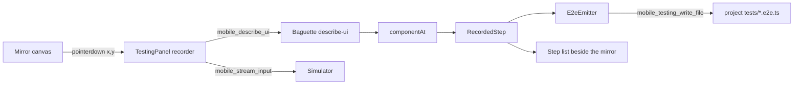

# Testing panel — record e2e tests from the mirror

Status: steps 1-4 of the build order are implemented — the tab, the project picker, launching the
app, tap recording with selector resolution and a live preview, and saving the test into the
project. Swipes, typing and the Run button are still design only.

A new workspace tool, **Testing**, that turns the existing simulator mirror into a
Maestro-Studio-style recorder: pick a project, launch its app, tap the mirror, and watch the test
source grow one step per interaction. The file is written to the project when the user clicks Save.

First pass targets the **iOS simulator** and the **e2e** runner (`@e2e-dev/mobile`).
Maestro YAML is a second emitter behind the same recorder.

## Scope of the first pass

| Decision | Choice |
|---|---|
| Platform | iOS simulator only (Baguette stream path) |
| Tap → code | Resolve a selector from the accessibility tree; fall back to coordinates |
| Output | Live **preview** in the panel; written to the project's `tests/<name>.e2e.ts` only on **Save** |
| Emitter | e2e TypeScript now; Maestro YAML later, same recorder |

Android (`serve-emu`) and physical iOS (`ios-mirror`) are explicitly out of the first pass.
Both already have input and hierarchy paths, so they slot in behind the same interfaces.

## What already exists

Almost every primitive is in place; the panel is mostly wiring.

| Need | Existing piece |
|---|---|
| Mirror frames | `packages/core/src/stream-sessions.ts:78` → MCP `resources/read`, drawn on canvas in `packages/ui/src/simulator-panel.ts` |
| Pointer capture over the mirror | canvas `pointerdown/move/up` at `packages/ui/src/simulator-panel.ts:855-892` |
| Touch injection | `mobile_stream_input` (`packages/core/src/panel-tools.ts:343-390`) → `stream-input.ts` batching |
| Accessibility tree | `baguette.describeUi(udid)` (`packages/core/src/baguette.ts:118`), exposed as `mobile_describe_ui` (`panel-tools.ts:292`) |
| Hit-testing a point | `componentAt` / `componentsAt` (`packages/shared/src/screen-annotations.ts:89,120`), already driving hover/select in the mirror |
| Tab registration | `toolNames` in `packages/ui/src/workspace-tools.ts:11`, label/icon map in `packages/mcp-app/src/components/workspace.tsx:27` |
| Maestro replay (later) | agent-device script-replay runs compatible Maestro YAML (`packages/runtimes/agent-device/tools.json`) |

Two things do **not** exist:

1. **No path writes into the user's project.** Every `writeFile` in the server targets its own
   state (recordings, tracesift, clipboard temp files). The server does not know a project root.
2. **No codegen of any kind.**

## Architecture



### 1. The tab

- Add `"testing"` to `toolNames` (`packages/ui/src/workspace-tools.ts`).
- `TestingPanel` controller in `packages/ui/src/testing-panel.ts`, same `subscribe`/`getSnapshot`
  store pattern as `LogsPanel`.
- `packages/ui/src/components/testing-view.tsx` renders the step list, the project picker, the
  record/stop control and the generated source.
- Entry in the label/icon map in `workspace.tsx`.

The view sits where the other tool views sit — beside the mirror, which `DeviceWorkspace`
already renders. No new mirror.

### 2. Project selection and launch

The panel has no notion of a project today. Add:

- **The user always picks the project explicitly** — the panel never infers it from the server's
  cwd. A folder picker; the choice is persisted so it is one click on the next session. Validate it by
  reading `e2e.config.ts` (or `package.json` depending on `e2e`). Persist the last choice in
  panel state.
- Read the chosen `e2e.config.ts` to learn the **target** and the **bundle id**, so the recorder
  launches the same app the generated test will (`app: { bundleId: … }`). Parsing TypeScript config
  is the awkward part — prefer shelling out to the project's own `npx e2e config --json` if the CLI
  exposes it; otherwise fall back to asking the user for the bundle id once and caching it.
- Launch via the existing device/app tooling (`DeviceAppsStore`), not a new path.

### 3. Recording a tap

The ordering matters, and it is the one genuinely tricky part:

1. `pointerdown` on the canvas. **Before** forwarding input, the recorder needs the hierarchy of
   the screen as it is *now* — after the tap it may be gone.
2. Keep a **cached tree**, refreshed on screen-settle (the mirror already knows when frames stop
   changing) and invalidated on every injected input. On `pointerdown`, hit-test against the cache;
   if the cache is stale, issue `mobile_describe_ui` and hold the input for one round trip (tens of
   ms on loopback — acceptable; a dropped tap is not).
3. Forward the touch to the device exactly as today, so the app behaves normally while recording.
4. `componentAt(point)` gives a `ScreenComponent { role, identifier, label, value, bounds, react }`.

While recording, `pointermove` runs the same resolution against the same cached tree and draws an
outline over the mirror with the step it would record (`packages/ui/src/components/test-recorder-overlay.tsx`).
It is a preview, not a second code path: what is outlined is what a tap records. The outline is
cleared whenever the cache is invalidated, because the screen it described is gone.

### 4. Selector resolution

Priority, first match wins:

| Rank | Source | Emitted |
|---|---|---|
| 1 | `identifier` (testID) | `screen.getByTestId("Submit")` |
| 2 | `role` + `label` | `screen.getByRole("tab", "Explore")` |
| 3 | text content (`label`/`value` on a text node) | `screen.getByText("GET STARTED")` |
| 4 | nothing resolves | `screen.tapAt(x, y)`, preceded by a wait, + a `// TODO: add a testID` comment |

`screen.tapAt` is the only step with nothing to wait on: every locator action waits up to the
action timeout for its element, but a coordinate is always "ready", so a recorded coordinate tap
fires into the splash screen and misses. A point step therefore carries an **anchor** — the
nearest element on the same screen that resolves uniquely — and the emitter puts
`await expect(<anchor>).toBeVisible()` in front of the tap as the gate the tap cannot express.

An **assertion** that resolves to a point is refused outright rather than recorded: there is
nothing for `toBeVisible` to name, so the step would emit only comments.

The ranks are tried over the **hit ladder** — every element the point sits inside, ordered by area,
innermost first — not over one element and not over one tree's branch. The inspection merges two
trees over the same pixels, React Native fibers and iOS accessibility, and they are not related by
`parentId`, so following a single branch can lose the half that names the element.

**Only accessibility nodes are named.** The inspection merges React Native fibers with the
device's accessibility tree, and the two disagree about the same pixels. The runner queries only
the second, so a selector built from the fibers can describe the screen perfectly and still fail
with `LOCATOR_NOT_FOUND`. On the stock Expo Explore screen:

| Element | Fibers say | Accessibility says | What the runner resolves |
|---|---|---|---|
| Collapsible header | `Pressable` > `Text` "File-based routing" | one element, name "Forward, File-based routing" (the chevron's name folded in) | `getByLabel("Forward, File-based routing")` |
| Tab bar item | unlabelled `Pressable` | `AXRadioButton` "Explore" | `getByRole("tab", "Explore")` |
| Paragraph | `RCTText`, nested children | `AXStaticText` with the whole string | `getByText(...)` |

So the ladder is built from accessibility nodes, and the fibers are used only where a point has
no accessibility node at all (an Android snapshot, a runtime-only tree), where a fiber-named
selector still beats a coordinate.

`getByText` searches text elements. A control whose accessible *name* merely contains words — a
row, an icon button, a collapsible header — is reached by that name, which is `getByLabel`; the
rank is added after text for exactly that case. Names are compared with whitespace collapsed,
because the runner normalizes and an accessibility label carries the rendered line breaks.

An icon-only control with no name of its own takes the **one** piece of text inside it; two and it
stays unnamed and the ladder moves outwards, rather than guessing.

**The status bar is not the app.** The device reports its own clock, Dynamic Island and battery in
the same tree. The runner queries the app and never sees them, so they are dropped — anything
lying wholly within the top 7% of the screen and carrying no identifier. They were otherwise
chosen as steps, and as waits: a recorded flow opened with
`await expect(screen.getByLabel("Dynamic Island, Empty")).toBeVisible()`.

**The stale bridge is repaired, not just reported.** `Baguette.describeUi` already restarts the
accessibility bridge when the simulator answers "no accessibility data" — but a stale bridge does
not always fail. It answers `ok`, with the chrome and an unnamed root. The root of a healthy tree
is the foreground app and it is named, so an unnamed root now triggers the same restart and one
re-read (`packages/core/src/baguette.ts`). The panel guard below stays as the backstop for when
the restart does not take.

**When the tree holds only the status bar, recording stops.** It comes back that way sometimes —
the app's own nodes missing while the simulator's chrome is reported. The fibers are still there
and still describe the screen, so resolution would quietly fall back to them and emit a selector
that cannot resolve at run time. `treeHealth` names the three cases — `ok`, `chrome-only`,
`no-accessibility` — and the recorder refuses a step on `chrome-only` with what to do about it.
`no-accessibility` is the honest fibers-only case (Android, a runtime-only tree) and still
records.

**Depth beats rank**: the innermost element that can be named at all wins, and the ranks above
only order the candidates *within* one element. An enclosing element is reached by pointing at it
or by walking out, never by quietly outranking what is under the pointer.

**Walking out.** The outline is at a level on the ladder, and the wheel over the mirror moves it:
out to the enclosing element, back in again, re-resolved from the cached tree at no cost. The label
reads `3/7`. Pointing at a different element starts again from the innermost. The recorded step is
whatever the outline shows, so what you see is what is written.

**Roles are translated, not passed through.** The device's vocabulary is not the runner's: iOS
accessibility reports `AXRadioButton` for a tab bar item, React Native inspection reports the fiber
name, so a `<Text>` arrives as `RCTText`. The runner's role union is *closed*, so an untranslated
role is a type error in the saved file rather than a query that misses. `normalizeRole` maps what
it can (`AXRadioButton` → `tab`, `RCTImageView` → `image`) and returns `""` for anything with no
equivalent, which drops the role rank and names the step by its text. A React Native label that is
just the component name is not text either, and is ignored.

Uniqueness check: run the candidate selector back over the same tree. If it matches more than one
node, fall to the next rank, and if all ranks are ambiguous, emit the best one with an index and
flag the step in the UI. The step list should show the chosen selector and let the user override it
from the other candidates — that override is what makes recorded tests maintainable.

iOS bounds are device points, matching the mirror's own coordinate space after the canvas scale
factor is applied; no normalization needed on this path. (Android bounds are screen pixels —
handle at the adapter, not in the emitter.)

### 5. Gestures beyond tap

- **Swipe**: `pointerdown`→`move`→`up` with distance over a threshold → `screen.swipe(...)`,
  anchored on the component under the start point when one resolves.
- **Typing**: key messages already flow through `stream-input`. Coalesce a run of keystrokes into
  one `.fill("…")` on the focused field; `type_secret`-style values must never be written to the
  file — emit a placeholder and a comment.
- **Long press**: `pointerdown`/`up` delta over ~500 ms.

### 6. Assertions

A recorder that only taps produces worthless tests. Two affordances:

- An **Assert** mode button: the next click on the mirror does not forward input; it picks the
  component under the cursor and emits `await expect(<selector>).toBeVisible()` (or
  `.toBeSelected()` for a selected tab, `.toHaveText(...)` when the node has text).
- Auto-insert `await expect(<selector>).toBeVisible()` before each tap, behind a toggle. This is
  what makes a recorded flow fail at the right step instead of three steps later.

### 7. Emitting and writing

`RecordedStep[]` is the single source of truth. Emitters are pure functions over it:

```ts
interface StepEmitter {
  readonly id: "e2e" | "maestro";
  emit(steps: RecordedStep[], meta: { title: string }): string;
}
```

The e2e emitter produces exactly the shape of a hand-written deterministic test:

```ts
import { test } from "@e2e-dev/mobile";
import { expect } from "e2e";

test("<title>", async ({ app, screen }) => {
  await app.open();
  await expect(screen.getByRole("tab", "Home")).toBeSelected();
  await screen.getByRole("tab", "Explore").tap();
  // …
});
```

No `agent.act` is ever emitted — the whole point of recording is determinism.

Writing needs a new **app-only** MCP tool in the server process:

- `mobile_testing_write_file({ projectRoot, relativePath, contents })`
- Annotated as a write so the host prompts; the panel must not be able to write anywhere by
  accident. Constrain `relativePath` to `tests/` under the chosen root, reject `..`, refuse symlinks.
- **It fires only when the user clicks Save.** One tool call, one host prompt, per save — not per
  tap. This is what makes the permission story tolerable.

While recording, the panel holds `RecordedStep[]` and renders the emitted source as a **live
preview** beside the step list, syntax-coloured by a tokenizer written for exactly the file the
emitter produces (`packages/ui/src/code-highlight.ts`) rather than a highlighting library — the
panel ships as one HTML file and a grammar would dwarf what it renders.

The lines a step adds are **tinted as they arrive** and fade back into the file. The user is
looking at the mirror when a step is recorded, not at the preview, so the new lines have to be
findable a second later. The file is re-emitted whole on every change, so "what is new" is
recovered by matching the previous render from both ends (`changedLines`); the marked lines are
keyed by a generation so each step animates, not only the first. The preview is always a full re-emit from the steps, so editing or
deleting a step just re-renders; nothing is ever half-written.

Save behaviour:

- **Record starts a new flow** when the steps on screen are already saved, and continues the
  existing one when they are not — stopping to scroll and carrying on is still one flow, but a tap
  landing on the end of a finished test never is.
- **A successful save stops the recording.** The flow is written; leaving the recorder armed turns
  the next stray tap on the mirror into a step the saved file does not have. The steps stay, so the
  flow can be extended and saved again. A save blocked by an existing file changes nothing.
- A filename field, defaulted from the test title (`tab-navigation` → `tests/tab-navigation.e2e.ts`).
- If the target exists, the panel says so and the user confirms an overwrite before the tool runs.
- The panel tracks a dirty flag: steps recorded since the last Save. Stopping or switching projects
  with unsaved steps warns.

Alternative considered and rejected: debounced live-write after every tap. It is what Maestro Studio
feels like, but each write is an MCP tool call and so a host permission prompt — unusable in a
recorder where a flow is thirty taps.

### 8. Replay

A **Run** button in the panel shells `npx e2e run tests/<file>` in the project root and streams the
result into the step list, marking the step that failed. This closes the loop: record, run, fix the
selector, run again.

## Reading the same tree as the runner

The recorder reads the accessibility tree through Baguette, over the macOS accessibility API. The
runner reads it through the vendored agent-device engine, over XCUITest. They agree about names
and roles — that was checked element by element against a live app — but not about reliability:
Baguette's bridge goes stale, and its tree carries the simulator's own chrome, which XCUITest
never shows.

Closing that for good means reading from agent-device, which this plugin already vendors and
drives (`packages/core/src/agent-device-runtime.ts`; app-flow's manual recorder takes snapshots
with node rects through it). It is not free:

| | Baguette `describe-ui` | agent-device `snapshot` |
|---|---|---|
| What it costs | one loopback GET, tens of ms | 0.3–1.5 s per read |
| What it needs | nothing | a session from `open`, which foregrounds or relaunches the app under the user's mirror |
| What it sees | the app plus the simulator's chrome | exactly what the runner sees |

A tap holds the touch until the read returns, so a second per tap is not a detail. The order is
therefore: repair the bridge and drop the chrome (done), and move to agent-device if staleness
survives that — reusing app-flow's manual session rather than opening a second one.

## Maestro, later

Nothing above is e2e-specific except the emitter and the run command. Adding Maestro means:

- a `MaestroEmitter` producing YAML (`- tapOn: { id: … }`),
- a run path through the existing agent-device script-replay tool,
- a format switch in the panel.

The selector ranks map cleanly: `identifier` → `id`, text → `text`, point → `point`.

## Resolved against e2e v0.17.0

- **`screen.tapAt(point, options?)` exists** (`e2e/dist/types.d.ts:296`), with the point in CSS
  pixels. Rank 4 of the selector table is valid as written.
- **No `e2e config --json`.** The CLI has `init`, `login`, `logout`, `models`, `guide`, `mcp`,
  `run`, `explore`, `list`, `cache`, `feedback`, `telemetry`. `e2e list --reporter json` prints
  `{ pairs: [...] }` — test/target pairs, which confirms a folder is an e2e project and names its
  targets, but does not expose the bundle id.
  So: validate the project with `e2e list --reporter json`, and get the bundle id by reading
  `e2e.config.ts` with a light regex, falling back to asking the user once and caching it.
  Parsing the config properly would mean executing TypeScript in the server process — not worth it.

## Open questions

None blocking.

## Build order

1. ~~Tab + empty panel registered in all hosts.~~ Done: `testing` in `toolNames`
   (`packages/ui/src/workspace-tools.ts`), the tab in `packages/mcp-app/src/components/workspace.tsx`,
   `TestingPanel` (`packages/ui/src/testing-panel.ts`) and `TestingView`
   (`packages/ui/src/components/testing-view.tsx`).
2. ~~Project picker + launch, no recording.~~ Done: `mobile_testing_projects`,
   `mobile_testing_choose_project` and `mobile_testing_project_config`
   (`packages/core/src/testing-tools.ts`, `packages/core/src/testing-projects.ts`), with launch
   going through the existing `mobile_launch_app`.
3. ~~Tap recording with selector resolution, step list and live source preview in the panel.~~
   Done: `TestRecorder` (`packages/ui/src/test-recorder.ts`) with the pure selector and emitter
   logic in `packages/shared/src/test-recording.ts`, taps intercepted on the mirror canvas in
   `packages/ui/src/simulator-panel.ts`, and the step list and preview in `TestingView`.
   The Assert button records `toBeVisible()` without forwarding the touch.
4. ~~`mobile_testing_write_file` + the Save button and overwrite confirmation.~~ Done:
   `writeTestFile` and `resolveTestPath` (`packages/core/src/testing-projects.ts`) confine the
   write to the project's `tests/`, refuse `..`, a non-`.e2e.ts` name and a symlinked folder or
   file, and report an existing file back instead of replacing it; `TestingPanel.saveTest`
   asks before overwriting and tracks saved-versus-dirty against the recorder's revision.
5. Assertions, swipe, typing.
6. Run button.
7. Maestro emitter.
